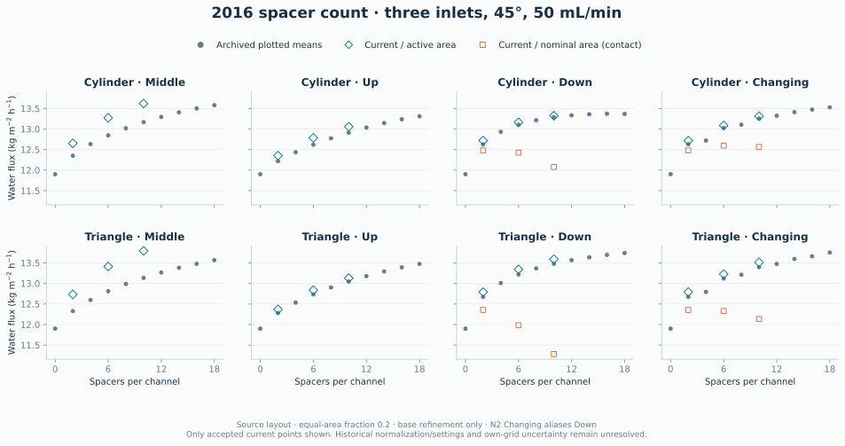

# Paper comparisons

## 2012: experimental validation and spatial polarization

Source: Gruber et al., DOI 10.3390/membranes2040764. Parameters in section 3.1:

| Parameter | Published | SI value used |
|---|---:|---:|
| A | 0.44 +/- 0.05 LMH/bar | 1.222222222222e-12 m/(Pa s) |
| B | 0.087 +/- 0.018 LMH | 2.416666666667e-8 m/s |
| K | 0.72 +/- 0.23 s/um | 720000 s/m |

Table 2 and Figures 5-7 use 1 M draw, pure-water feed, and 50 mL/min per
compartment. Simulations use half-width symmetry, so each simulated compartment
receives 25 mL/min. Molarity is converted with the concentration-dependent density.

| Chamber | Published CFD water, kg/(m2 h) | Published CFD salt, g/(m2 h) | Experimental water | Experimental salt |
|---|---:|---:|---:|---:|
| A | 5.46 | 1.35 | 5.64 +/- 0.52 | 1.44 +/- 0.28 |
| B | 5.54 | 1.37 | 5.72 +/- 0.40 | 1.60 +/- 0.39 |

The chamber generators derive from the September 2012 `createSMTCdict.py` (A)
and `createFO21Dict.py` (B). Dimensions match the published chambers; exact
identity with the publication meshes is unverified.

Chamber A uses millimetre scaling (`convertToMeters=0.001`), omits four unused
curved edges, and sets the inlet connection offset to 0.05 mm instead of
0.025 mm to avoid sliver faces.

The generators preserve the original geometry construction. Mesh assembly uses
`mirrorMesh -overwrite`, face-zone selection, and `createBaffles`. The inlet/outlet
patches are selected geometrically rather than split using hard-coded face counts.
`checkMesh` must pass before assigning fields and running a case.

## 2012 simulation results

Both geometries pass `checkMesh`. CPU results (four or eight ranks):

| Chamber | Cells (simulated half-width) | Water, kg/(m² h) | Salt, g/(m² h) | Salt imbalance / membrane transfer |
|---|---:|---:|---:|---:|
| A | 326,720 | 5.833361 | 1.436791 | 0.036% |
| A | 707,408 | 5.827270 | 1.435290 | 0.09871% |
| B | 553,560 | 5.615727 | 1.383166 | 0.08230% |
| B | 1,140,744 | 5.627176 | 1.385987 | 0.0971% |
| B | 1,926,360 | 5.628058 | 1.386204 | 0.09989% |
| B | 4,428,480 | 5.625746 | 1.385635 | 0.09378% |

On the finest accepted meshes, water flux differs from published CFD by +6.7%
(A) and +1.5% (B); salt flux differs by +6.3% and +1.1%. All four predictions
fall within the published experimental ranges. Geometry and discretization
differences prevent a direct comparison of the historical numerical fields.

The cases use linear-upwind momentum convection, van Leer salt convection,
two non-orthogonal pressure corrections, salt relaxation 0.2, and linear pressure
tolerance 1e-12. SIMPLE residual limits are 1e-6 for pressure/velocity and 1e-9
for salt, with the additional integral salt-conservation stopping condition.
Pressure/velocity relaxation is 0.15/0.3 for A and 0.3/0.7 for B.
The default Chamber A GAMG solver retains 100 cells at the coarsest pressure level and solves that level
directly. It uses DIC–Gauss–Seidel smoothing for flow initialization, then restores
the steady solver settings.
The example runner exports dictionaries, residuals, and membrane surface values
to the chosen results directory.

Small interior mass-fraction undershoots remain: minima are approximately
-4.2e-8 in the refined A case and -3.7e-8 in B, compared with a draw mass
fraction of 0.0564.
They are recorded without clipping. Membrane concentrations remain admissible.
Chamber B has four accepted meshes under the same 0.1% integral
salt-imbalance gate. Water flux changes +0.204% from the coarse to the 1.25× mesh,
then +0.01567% on the 1.5× mesh. The draw-surface concentration integrals are:

| B cells | Draw-side concentration integral, m² |
|---:|---:|
| 553,560 | 1.7574121e-5 |
| 1,140,744 | 1.7645680e-5 |
| 1,926,360 | 1.7651813e-5 |
| 4,428,480 | 1.7637633e-5 |

Independent CSV integration confirms both membrane areas and integrals on all
four meshes. Refinement from 1.25× to 1.5× changes the integral by +0.03476%.
The 2× mesh then changes water flux by -0.04109% and the draw integral by
-0.08033%, reversing the previous trend. Using effective
spacing proportional to `cells**(-1/3)` and the nonuniform refinement ratios,
the first three meshes give apparent orders of about 10.2 for water flux and
9.8 for the draw integral. The fourth mesh does not support extrapolating that
monotone single-power fit; a validated asymptotic GCI remains unavailable.
The fourth grid also passes after matching the preceding grids' salt relaxation
of 0.2: water flux differs by only 6.6e-8 relative from the accepted 0.3-relaxation
solution. This follows 100 forced verification steps and a separate solve with
the original residual and conservation gates restored. Its last 100 accepted
flux samples and independently integrated membrane fields are stable. Initialization
temporarily uses salt relaxation 0.9; it is restored before acceptance.
The comparison and maps use
the finest accepted mesh. Chamber A grid independence and quantitative agreement
with the published spatial distributions remain unverified.

The first accepted A refinement has 707,408 cells, water 5.827270 kg/(m² h),
salt 1.435290 g/(m² h), salt imbalance 0.00098710 and mass imbalance 4.00e-14.
Independent integration of 7,376 faces per side confirms paired active area
0.000221077433 m² and draw/feed concentration integrals
1.18707864e-5 / 2.61612632e-9 m². All 11,496 pressure solves across its four
completion invocations meet the declared absolute/relative target; the final
100 completed iterations have relative water-flux span 8.91e-8.
The recorded trace undershoot is not clipped and remains within the existing
physical-field allowance. Water is 0.1044% below the earlier coarse result and
6.727% above the published CFD value 5.46. This single refined point does not
establish a consistent three-grid sequence or GCI; the coarse initializer's
historical mesh and solver provenance require separate qualification.

This refinement uses PCG/DIC, absolute 1e-12, relative 0.001 and at most
2,000 pressure iterations, with reference relaxation 0.15/0.3/0.2.
The accepted trajectory maps a converged same-input coarse field as an initial
guess, briefly accelerates scalar relaxation, then restores those reference
settings and every original gate before acceptance. A mapped field or a
pressure-qualified startup is not itself an accepted result.
Prepare the same steady problem and set its pressure method explicitly:

```bash
case=runs/chamber-a-refined
python3 examples/run.py chamber-a "$case" --refinement 1.25 \
    --salt-imbalance 0.001 --end 60000 --setup-only
foamDictionary "$case/system/fvSolution" -entry solvers.p -set '{
    solver PCG; preconditioner DIC;
    tolerance 1e-12; relTol 0.001; maxIter 2000;
}'
foamDictionary "$case/system/fvSolution" -entry solvers.pFinal -set '{
    $p; relTol 0;
}'
```

Solve with `simpleSaltTransport` and collect with
`python3 examples/run.py chamber-a "$case" --collect-only --results runs/results/chamber-a-refined`
without regenerating the dictionaries. Fresh initialization can require more
startup work than the mapped trajectory. For parallel execution, write a
`decomposeParDict` with the desired rank count, run `decomposePar`, and use
`mpirun -np <ranks> simpleSaltTransport -parallel -case "$case"`.
The paired-surface plotter tolerates exported centre rounding while requiring
a unique face correspondence; missing or ambiguous pairs are rejected.

The [2012 paper, §2.3, Eq. (7)](https://doi.org/10.3390/membranes2040764), prints
`GCI_coarse = 3*abs(e)*R**3/(R**3 - 1)` and defines `R` as the fine/coarse
cell-count ratio. The conventional GCI uses a grid-spacing ratio and a
convergence order; in three dimensions the effective spacing ratio is
`(N_fine/N_coarse)**(1/3)`, as described in
[NASA's spatial-convergence guidance](https://www.grc.nasa.gov/www/wind/valid/tutorial/spatconv.html).
The printed definition differs from this prescription; its historical
implementation is unverified. Applying the printed cell-count formula with an
explicitly coarse-normalized concentration-integral difference gives 1.36%
for 553,560 versus 1,926,360 cells, or 0.132% for 1,140,744 versus 1,926,360 cells. These
are comparisons with the printed criterion, not validated uncertainty bounds.

The finest B study uses PCG with a GAMG preconditioner after standalone GAMG
pressure solves stalled near their 1e-12 absolute tolerance. This changes the
linear solution method, preserving the equations, tolerances and acceptance
gates. OpenFOAM v2606 requires the preconditioner's controls in a nested
`preconditioner` dictionary. To reproduce this configuration from a fresh case:

```bash
case=runs/chamber-b-refinement-2
python3 examples/run.py chamber-b "$case" --refinement 2 --end 60000 \
    --salt-imbalance 0.001 --setup-only
foamDictionary "$case/system/fvSolution" -entry solvers.p -set '{
    solver PCG;
    preconditioner {
        preconditioner GAMG;
        smoother DICGaussSeidel;
        tolerance 1e-6;
        relTol 0.1;
        nVcycles 2;
    }
    tolerance 1e-12;
    relTol 0.001;
    maxIter 2000;
}'
cat > "$case/system/decomposeParDict" <<'EOF'
FoamFile { version 2.0; format ascii; class dictionary; object decomposeParDict; }
numberOfSubdomains 8;
method simple;
simpleCoeffs { n (8 1 1); delta 0.001; }
constraints { membranePairs { type preserveBaffles; } }
EOF
decomposePar -case "$case" > "$case/log.decomposePar" 2>&1
mpirun -np 8 simpleSaltTransport -parallel -case "$case" \
    > "$case/log.solver" 2>&1
python3 examples/run.py chamber-b "$case" --collect-only \
    --results runs/results/chamber-b-refinement-2
```

Use `--salt-imbalance 0.001` to require the stricter integral gate during
steady solving and collection. The requested limit is stored in the result
metadata and cannot be replaced by the collector’s default 1% limit.

Use `--refinement` to increase the block cell counts while preserving dimensions
and grading:

```bash
for refinement in 1 1.25 1.5 2; do
    for chamber in a b; do
        case="chamber-$chamber-refinement-$refinement"
        python3 examples/run.py "chamber-$chamber" "runs/$case" \
            --refinement "$refinement" --salt-imbalance 0.001 --ranks 8 --results "runs/results/$case"
    done
done
```

At refined port intersections, the runner checks the quarter mesh and uses
OpenFOAM's `collapseEdges` to remove identified sliver faces before mirroring.
The edge-length threshold is 10 nm; the collapse filter's minimum volume is
1e-18 m³ to accommodate the millimetre-scale channels. The assembled mesh must
still pass the standard `checkMesh` checks. Refinement factors can interact with
the legacy port intersections, so a finer mesh is not automatically a valid mesh.
Passing mesh checks alone does not establish flux or surface-field convergence.
The 2012 comparison and surface plots select the finest converged, conserved
record for each chamber at the published operating point.

Figures 5–7 are recreated as surface maps. External polarization is membrane
surface mass fraction divided by inlet draw mass fraction. Internal polarization
uses the support/active-layer interface concentration from Eq. 14, divided by
the same inlet value. Water maps show mass flux. Colour scales are independent
between chambers; consult the labelled ranges when comparing them. The plots
reflect the simulated half-width and display face-centre values without interpolation.

## 2016 chamber dimensions

Source: Gruber, Aslak & Hélix-Nielsen, DOI 10.1016/j.seppur.2015.12.017.
Figure 2 compares 5, 50 and 500 mL/min with the rectangular-channel film model,
Eqs. 4 and 9–11. Reference CFD values are transcribed from the authors' Figure 2
numerical tables in `paper_models.py`; they are benchmark inputs.

| Parameter | Value |
|---|---:|
| Membrane length / width | 85 / 39 mm |
| Channel height per compartment | 2.25 mm |
| Total compartment height | 19.25 mm |
| Inlet diameter / edge offset | 5.5 / 4.5 mm |
| Draw / feed salt mass fraction | 0.065 / 0.00065 kg/kg |
| Water permeability A | 1.61111e-12 m/(Pa s) |
| Salt permeability B | 8.33333e-8 m/s |
| Support resistance K | 150666 s/m |

The original `Jw_vs_dimensions/createPlots.py` specifies these membrane
parameters and concentrations. The concentrations also appear explicitly in the
[historical case initialization](../tests/simple3dMesh/system/setFieldsDict).
The analytical calculation uses constant diffusivity 1.45e-9 m²/s and reference
density 1000 kg/m³ for conversion to mass flux. Independent samples from the original
analytical curves agree within 0.06 kg/(m² h), the figure's digitization tolerance.
The CFD solvers retain concentration-dependent density and diffusivity.

Table 1 prints K=6.64 s/µm, which converts to 6,640,000 s/m. This conflicts with
the original plotting code and case dictionaries. It is not used for the
reference comparison: even without external concentration polarization it
limits flux to about 1.46 kg/(m² h), below the archived CFD range of 8.80–13.22.
The recovered value is 0.150666 s/µm; its reciprocal is 6.6372 µm/s, which
rounds to the table's 6.64 with inverse units. This is consistent with a
reciprocal/unit error in the table, although the original numerical inputs
do not establish how the error arose. The reference cases use those inputs
rather than fitting K to the published fluxes.

The CF042 generator uses half-width symmetry, paired membrane faces, rounded
channels and distributors, and circular ports. Each compartment receives half
the specified whole-module flow. Feed and draw enter opposite ends. The
reconstruction assumes a channel corner radius of half the inlet diameter,
distributor half-span `width/2 - diameter/2`, and distributor top height
`chamber_height - diameter/2`; a curved block transition connects it to the pipe.
These details are not uniquely specified by the published drawings. The
[original toolkit generator](https://github.com/MathiasGruber/MembraneSimKit/blob/2c4344144dadc3f2b486432724468a91652bbe3a/src/meshLibrary/setupScripts/blockCF042/meshSetup.py)
provides a separate construction with configurable corner radius, distributor
width and inlet height. Its default inlet diameter is 4.5 mm, whereas the paper
specifies 5.5 mm; toolkit defaults alone therefore do not identify the paper's
case settings. This example remains a reconstruction, and exact identity with
the original mesh is unverified.

Default tangential spacing is 0.8 mm with 24 cells through each channel and
wall-normal expansion ratio 100, giving approximately 4 µm at the membrane.
Use `--spacing 0.0004 --layers 48` for a finer grid. Every mesh must pass
`checkMesh`. Solver stopping requires salt residual below 1e-9 and salt
imbalance below 0.1% of membrane transfer. The plotter includes new CFD points
only after convergence and conservation checks; original CFD points are always
labelled separately.

Converged reconstructed CF042 results:

| Flow (mL/min) | Cells | Water, kg/(m² h) | Salt, g/(m² h) | Difference from archived water flux | Salt imbalance / transfer |
|---:|---:|---:|---:|---:|---:|
| 5 | 158,912 | 8.382253 | 5.392870 | −4.7% | 0.0114% |
| 50 | 158,912 | 11.180289 | 7.196734 | −1.7% | 0.0046% |
| 50 | 396,340 | 11.184071 | 7.199158 | −1.6% | <0.1000% |

Relative mass imbalance is below 4e-12. The two 50 mL/min grids differ by 0.034%
in water flux and 0.081% in the draw-surface concentration integral. A third
grid is needed to establish chamber grid independence; the difference from the
archived CFD results remains unresolved.

The original toolkit construction, with the paper's 5.5 mm port and source
wall-normal expansion ratio 5, also converges at 50 mL/min: 826,280 cells,
water 11.188519 kg/(m² h), salt 7.202058 g/(m² h), relative salt imbalance
0.09983% and relative mass imbalance below 1e-12. Its draw-side membrane area
is 0.001653579 m² and its concentration integral is 6.813829e-5 m². Water flux
remains 1.6% below the archived 11.37. This independently constructed mesh is
within 0.040% of the finest accepted reconstruction, but the meshes have
different grading and topology; that agreement is not a grid-convergence
study. The source grading gives a nominal first-cell thickness of 35.90 µm.
This first-cell thickness is a mesh input, not proof of convergence.
Original-construction markers are labelled separately in the figure.

With the same original geometry and expansion ratio 100, the 826,280-cell
baseline converges at water 11.160097 kg/(m² h) and salt 7.183743 g/(m² h), with
relative salt imbalance 0.09911% and relative mass imbalance below 3e-13. Its
nominal first membrane cell is 3.9611 µm. Changing grading from 5 to 100 changes
water flux by −0.254% and the draw-surface concentration integral by −0.347%.
The grading-100 baseline remains 1.85% below the archived water flux.
It is the coarse member of the consistent refinement sequence below.

At expansion ratio 100 and refinement 1.25, the 1,541,448-cell mesh converges
in 6,758 iterations: water 11.166321 kg/(m² h), salt 7.187755 g/(m² h),
relative salt imbalance 0.09986% and relative mass imbalance below 7e-13.
The nominal first membrane cell is 3.2295 µm. Compared with the same-grading
baseline, water changes +0.0558% and the draw-side concentration integral
changes +0.0806% to 6.795666e-5 m². Both paired membrane sides have area
0.001653597 m². This result is 1.79% below the archived water flux.

At refinement 2, the 6,610,240-cell mesh converges in 8,131 iterations:
water 11.173889 kg/(m² h), salt 7.192635 g/(m² h), relative salt imbalance
0.09168% and relative mass imbalance below 9e-15. Its nominal first membrane
cell is 2.0368 µm. From refinement 1.25, water changes +0.06777% and the
draw-side concentration integral changes +0.09559% to 6.8021625e-5 m².
Both membrane sides have area 0.0016536226 m²; independent integration of
60,288 exported faces per side confirms these values.

Using effective spacing proportional to the inverse cube root of cell count,
the three nonuniform grids give apparent orders 1.972 for water and 2.048
for the draw integral. Richardson extrapolation gives water 11.178609
kg/(m² h); the conventional fine-grid GCI estimates, with safety factor 1.25,
are 0.0528% for water and 0.0701% for the draw integral. These are estimates
conditional on an asymptotic single-power error model, not independently
validated uncertainty bounds. Block-count rounding and grading require that
qualification. The finest computed water flux remains 1.725% below the
archived 11.37, substantially larger than the estimated discretization error;
this sequence does not close the historical-input or model discrepancy.

Initialize a refined mesh from an existing solution to reduce startup cost:

```bash
python3 examples/run.py cf042 runs/cf042-50-fine --ranks 8 \
    --spacing 0.0004 --layers 48 --initialize-from runs/cf042-50 \
    --results runs/results/cf042-50-fine
```

The source must have the same geometry and operating conditions. The runner uses
`mapFields` with the latest source time, supports decomposed sources, and resets
the coincident membrane boundary guesses before solving. This initialization
does not change the convergence or conservation requirements.
Dictionary updates retain 15-digit precision so resetting guesses preserves
the supplied material and inlet parameters.

### Original toolkit construction

Use `--cf042-geometry original` to run the recovered `blockCF042` construction:

```bash
python3 examples/run.py cf042 runs/cf042-original-50 --cf042-geometry original \
    --flow 50 --salt-imbalance 0.001 --ranks 8 \
    --results runs/results/cf042-original-50
python3 examples/run.py cf042 runs/cf042-original-50-fine --cf042-geometry original \
    --refinement 1.5 --initialize-from runs/cf042-original-50 --ranks 8 \
    --salt-imbalance 0.001 --results runs/results/cf042-original-50-fine
```

To repeat the expansion-100 refinement sequence with the same steady gates:

```bash
python3 examples/run.py cf042 runs/cf042-g100-r1 --cf042-geometry original \
    --wall-normal-expansion 100 --refinement 1 --end 60000 --ranks 4 \
    --salt-imbalance 0.001 --results runs/results/cf042-original-g100-r1
python3 examples/run.py cf042 runs/cf042-g100-r125 --cf042-geometry original \
    --wall-normal-expansion 100 --refinement 1.25 --end 60000 --ranks 4 \
    --initialize-from runs/cf042-g100-r1 --salt-imbalance 0.001 \
    --results runs/results/cf042-original-g100-r125
python3 examples/run.py cf042 runs/cf042-g100-r2 --cf042-geometry original \
    --wall-normal-expansion 100 --refinement 2 --end 60000 --ranks 4 \
    --initialize-from runs/cf042-g100-r125 --salt-imbalance 0.001 \
    --results runs/results/cf042-original-g100-r2
```

The generator preserves the source block topology, a 3 mm corner radius,
29.5 mm distributor width, 0.5 mm inlet buffer and 1 µm merge gap. Override the
first two with `--corner-radius` and `--distributor-width`. Total compartment
height remains `--chamber-height`; the intermediate inlet height is total height
minus channel height. The port diameter defaults to the paper's 5.5 mm, rather
than the toolkit's 4.5 mm. These explicit inputs must still be checked against
the case being reproduced; recovering a generator does not identify every
historical configuration.

The source quarter mesh is merged before mirroring along the length and across
the membrane. The runner splits feed/draw ports, creates paired membrane faces,
and requires `checkMesh` to pass before initializing fields. Identical duplicate
arc declarations are removed for v2606. The default full mesh contains 826,280
cells and two fluid regions. `--refinement` scales the original block counts;
`--spacing` and `--layers` apply only to the other construction. The original
channel grading ratio is 5, and its baseline contains 25 cells through each
channel. Use `--wall-normal-expansion` to test boundary-layer resolution while
preserving the geometry and cell counts. The result records the nominal first
cell height (full first-cell thickness), computed from the geometric progression.
At baseline resolution,
the nominal first cell is 35.90 µm for the source ratio 5 and 3.96 µm for ratio
100. Refinement 2 with ratio 100 gives 50 cells and a nominal 2.04 µm first cell.
These are mesh inputs, not proof of convergence. The source-default mesh needs
its own mesh-convergence study before paper-level conclusions.

Recovering the construction also does not recover every numerical setting.
The toolkit's [steady scheme template](https://github.com/MathiasGruber/MembraneSimKit/blob/2c4344144dadc3f2b486432724468a91652bbe3a/src/templatesFiles/fvSchemes_steadystate)
uses bounded upwind convection for velocity and salt, with cubic interpolation
in momentum diffusion. Its `laplacian(rhoD_AB,m_A)` cubic entry does not match
the coefficient field name `rho*D_AB` in the [archived transport equation](https://github.com/MathiasGruber/MembraneFoam/blob/e16269dccb5b154b2fe22ba61f726c35721050fb/src/solvers/simpleSaltTransport/m_AEqn.H);
that equation therefore selects the template's default linear diffusion.
The maintained examples instead use linear-upwind velocity convection and
van Leer salt convection. Numerical-scheme sensitivity must be distinguished
from geometry and material-parameter sensitivity; these archived templates
alone do not establish the settings of each published case.

On the original CF042 mesh with expansion 100, 826,280 cells and 50 mL/min,
changing only the numerical schemes gives:

| Convection / momentum diffusion | Water, kg/(m² h) | Salt, g/(m² h) | Relative salt imbalance |
|---|---:|---:|---:|
| Maintained linear-upwind / linear | 11.160097 | 7.183743 | 0.00099114 |
| Bounded upwind / linear | 11.242536 | 7.236947 | 0.00099972 |
| Maintained linear-upwind / cubic | 11.159955 | 7.183650 | 0.00044472 |
| Bounded upwind / cubic | 11.242568 | 7.236968 | 0.00099994 |

Salt convection is van Leer in the maintained rows and bounded upwind in the
upwind rows; salt diffusion remains linear in every row. All four use the same
geometry, material properties, pressure controls and relaxation. Each passes
the original residual limits, 0.1% integral salt gate, mass conservation and
physical concentration checks. Independent integration of 15,072 membrane faces
per side confirms their areas and concentration integrals. The combined schemes
increase water flux by 0.739% from the same-grid baseline and remain 1.121% below
the archived 11.37. This is scheme sensitivity on one mesh; the default-scheme
GCI above does not apply to the upwind result, and no parameter was fitted.

The matching combined-scheme grid sequence is:

| Cells | Water, kg/(m² h) | Draw-surface concentration integral, m² | Relative salt imbalance |
|---:|---:|---:|---:|
| 826,280 | 11.242568 | 6.84956946e-5 | 0.00099994 |
| 1,541,448 | 11.236259 | 6.84562460e-5 | 0.00099986 |
| 6,610,240 | 11.219007 | 6.83424425e-5 | 0.00099866 |

Every point uses matched physical inputs, effective source schemes, pressure
controls and relaxation, and passes all strict gates. The finest salt flux is
7.221747 g/(m² h), mass imbalance is 1.01e-14, and the final 100-sample water-flux
span is 4.92e-7 relative. Independent integration of 15,072, 22,632 and 60,288
faces per side confirms the respective areas and concentration integrals.
The finest solve uses a bounded scalar-relaxation phase as an initial-guess
accelerator, then restores the original 0.3 relaxation and every acceptance
gate before collecting the result.

Water decreases 0.05612% and then 0.15354%; the last draw-integral change is
−0.16624%. The finest water result remains 1.328% below archived 11.37.
The water difference ratio is 2.734, above the positive-order upper limit
2.335 for these effective-spacing ratios; the draw-integral sequence also
fails that test. Thus these three grids do not admit a positive monotone
Richardson order under the effective-spacing model. Source-scheme asymptotic
convergence and GCI remain unverified; the default-scheme estimate cannot be
transferred to this sequence. A fresh solve with the unchanged reference
settings targets the same steady problem; an accelerator is not required
for the reproduction recipe below.

To reproduce the effective steady-template schemes from a fresh case, prepare
the same geometry, replace convection and momentum diffusion, then solve and
collect without regenerating the dictionaries:

```bash
case=runs/cf042-source-schemes
python3 examples/run.py cf042 "$case" --cf042-geometry original \
    --wall-normal-expansion 100 --refinement 1 --flow 50 \
    --salt-imbalance 0.001 --end 60000 --setup-only
foamDictionary "$case/system/fvSchemes" -entry divSchemes -set '{
    default none;
    "div(phi,U)" bounded Gauss upwind;
    "div(phi,m_A)" bounded Gauss upwind;
    "div((mu*dev2(T(grad(U)))))" Gauss linear;
    "div((mu*dev2(grad(U).T())))" Gauss linear;
}'
foamDictionary "$case/system/fvSchemes" -entry laplacianSchemes -set '{
    default Gauss linear corrected;
    "laplacian(mu,U)" Gauss cubic corrected;
}'
simpleSaltTransport -case "$case" > "$case/log.solver" 2>&1
python3 examples/run.py cf042 "$case" --collect-only \
    --results runs/source-scheme-results/cf042
```

For the separate comparisons, omit the momentum-diffusion override or the
convection override, respectively. Keep these outputs separate from the
default-scheme grid study. Collected results retain the actual dictionaries.

Both constructions use the same membrane equations, material properties and
whole-module flow convention. Warm starts require matching construction and
geometry parameters. Collected results record the source revision and inputs;
the dimension plot distinguishes original-toolkit results with separate open
markers and the grading ratio in the legend. Reconstructed geometry uses open
diamonds. Grid selection remains separate for each construction and grading ratio.
Runs with nondefault corner radius or distributor width are excluded from that
reference plot. Mesh quality and startup checks do not establish a converged paper flux or
grid independence.

### Recovered CF042 port and distributor inputs

At 50 mL/min, expansion 100 and 826,280 cells, the same effective-source
schemes also converge with the independently recovered port/offset inputs:

| Port diameter, mm | Distributor offset, mm | Water, kg/(m² h) | Salt, g/(m² h) | Relative salt imbalance | Archived water gap |
|---:|---:|---:|---:|---:|---:|
| 4.5 | 4.25 | 11.290783 | 7.267993 | 0.00099993 | −0.6967% |
| 4.5 | 4.50 | 11.297444 | 7.272302 | 0.00099980 | −0.6381% |
| 5.5 | 4.25 | 11.239456 | 7.234948 | 0.00099996 | −1.148% |

The 5.5 mm / 4.50 mm same-grid baseline is 11.242568. The 4.5 mm port and
4.25 mm offset come from the recovered generator; the paper reports different
inputs. Historical per-case inputs remain unverified, and closer agreement
alone does not identify them. These geometry-input studies are separate from
the matching-grid sequences above; their own grid uncertainty remains open.

All three pass the original residual, physical and integral gates, with mass
imbalances below 3e-14. Independent integration of 15,072 faces per side gives
paired area 0.001653579065 m². Draw-side concentration integrals are
6.89334811e-5, 6.89730561e-5 and 6.84814820e-5 m²; feed-side integrals are
2.23134471e-6, 2.22500380e-6 and 2.23844482e-6 m², respectively.
Every recorded pressure solve meets its declared absolute/relative target;
the final 100 completed iterations have relative water spans
1.24e-7, 1.12e-7 and 9.11e-8.

For the recovered 4.5 mm / 4.25 mm inputs, the matching refinement-1.25 mesh
has 1,541,448 cells and passes at water 11.284585 kg/(m² h) and salt
7.263986 g/(m² h). Water changes −0.05489% from the 826,280-cell result and
is 0.7512% below archived 11.37. Relative salt imbalance is 1.0464e-5 and mass
imbalance is 2.09e-15. Independent integration of 22,632 faces per side gives
paired area 0.001653596803 m² and draw/feed concentration integrals
6.8897309604e-5 / 2.2360404753e-6 m². Geometry, materials, transport properties
and actual membrane A/B/K match the coarse case; only refinement changes.

All 6,363 recorded pressure solves meet their declared targets, with at most
nine iterations. Restored-reference iterations 2021–2120 have relative water
span 8.06e-10 before separate strict acceptance at 2121. The final invocation
contains only one completed iteration and two flux records; its stability
window is the separately audited preceding phase. Use `--refinement 1.25`
with the recipe below and the same numerical controls. Bounded scalar
acceleration is an initialization option; restore salt relaxation 0.3 before
acceptance. Two accepted grids do not establish an observed order or GCI,
and the historical per-case input match remains unverified.

Prepare a selected row using its explicit inputs, then apply the
effective-source scheme overrides above. For the recovered generator defaults:

```bash
case=runs/cf042-source-inputs
python3 examples/run.py cf042 "$case" --cf042-geometry original \
    --wall-normal-expansion 100 --inlet-diameter 0.0045 --offset 0.00425 \
    --flow 50 --salt-imbalance 0.001 --setup-only
```

Use GAMG with `tolerance 1e-12`, `relTol 0.001` and
`smoother DICGaussSeidel`, retaining pressure/velocity/salt relaxation
0.3/0.7/0.3. Solve and collect without regenerating dictionaries, as in the
source-scheme recipe. The reported trajectories start from same-input physical
fields and change only the numerical schemes; fresh initialization can take
longer. No membrane parameter is fitted to the archived flux.

## 2016 inlet geometry

The `3dblock` example generates the 80 × 40 mm chamber with a 2 mm channel
on each side of the membrane. Its rounded ends and 1 mm rectangular ports
follow the [archived quarter mesh](../tests/simple3dMesh/constant/polyMesh/blockMeshDict).
`--inlets` selects an odd whole-width count from 1 to 19; `--angle` selects
0–90° relative to the membrane. The default is three inlets at 45° and
50 mL/min. Feed and draw flow in opposite directions, with half-width symmetry.
The membrane parameters and concentrations are those listed above.

```bash
python3 examples/run.py 3dblock runs/block-3 --inlets 3 --angle 45 --ranks 8
python3 examples/run.py 3dblock runs/block-3-fine --inlets 3 --angle 45 \
    --refinement 1.25 --ranks 8
```

The port axes rotate about a point 0.5 mm toward the inlet from the rounded-end centre
and 0.5 mm above the membrane. Port faces meet the curved chamber wall directly.
The mesh partitions that wall at both port lips, avoiding thin cut cells.
`--refinement` increases cell counts in every direction while retaining the
geometry and wall-normal grading. Each generated mesh must pass `checkMesh`.
A passing mesh establishes numerical quality; agreement with the published
inlet-count and angle curves requires converged, mesh-resolved solutions.

Generate inlet-angle and inlet-count comparisons with the same runner:

```bash
for angle in 0 45 90; do
    python3 examples/run.py 3dblock "runs/inlet-angle-$angle" --angle "$angle" \
        --ranks 8 --results "runs/results/inlet-angle-$angle"
done
for count in 1 7; do
    python3 examples/run.py 3dblock "runs/inlet-count-$count" --inlets "$count" \
        --ranks 8 --results "runs/results/inlet-count-$count"
done
python3 examples/plot.py --results runs/results
```

The plotter writes `2016-inlets.svg` when eligible inlet-study results exist.
Filled circles are the authors' numerical reference tables; open diamonds are
new solutions. It selects the finest accepted mesh at each operating point,
excludes spacer and transient cases, and requires salt imbalance below 0.1%
of membrane transfer. Use `--flow` to repeat the studies at 5 and 500 mL/min.

At 50 mL/min, the accepted three-inlet solutions are:

| Angle | Cells | Water flux, kg/(m² h) | Archived flux | Salt imbalance |
| --- | ---: | ---: | ---: | ---: |
| 30° | 1,066,000 | 12.018934 | 11.90 | 0.09996% |
| 45° | 1,066,000 | 11.897860 | 11.90 | 0.09814% |
| 50° | 1,066,000 | 11.861254 | 11.90 | 0.09912% |
| 60° | 1,066,000 | 11.823157 | 11.89 | 0.09790% |
| 70° | 1,030,800 | 11.817270 | 11.89 | 0.03199% |
| 80° | 1,014,800 | 11.793435 | 11.89 | 0.08206% |
| 90° | 1,014,800 | 11.758823 | 11.89 | 0.04556% |

Salt imbalance is relative to membrane transfer; relative mass imbalance is
below 5e-12 for every listed case. The accepted 45°, 50 mL/min inlet-count points are:

| Inlet count | Cells | Water flux, kg/(m² h) | Archived flux | Salt imbalance |
| --- | ---: | ---: | ---: | ---: |
| 5 | 1,078,476 | 11.810781 | 11.91 | 0.00176% |
| 7 | 1,080,400 | 11.776103 | 11.92 | 0.00945% |
| 9 | 1,087,600 | 11.765107 | 11.92 | 0.09999% |
| 11 | 1,084,248 | 11.755738 | 11.92 | 0.04414% |
| 15 | 1,109,200 | 11.739117 | 11.92 | 0.07290% |

Their relative mass imbalances are 1.5e-12, 3.0e-12, 5.6e-12, 2.5e-12, and
1.7e-12. The fluxes lie 0.8% to 1.5% below the archived values, with the offset
growing from five to fifteen inlets.
A separate three-inlet, 45°, 50 mL/min grid sequence uses the effective
source-template schemes: bounded upwind velocity/salt convection, cubic momentum
diffusion and linear salt diffusion:

| Refinement | Cells | Water, kg/(m² h) | Draw-surface concentration integral, m² | Relative salt imbalance |
|---:|---:|---:|---:|---:|
| 1 | 1,066,000 | 11.973892 | 7.20449638e-5 | 0.00099909 |
| 1.25 | 2,288,976 | 11.973458 | 7.20430071e-5 | 0.00099894 |
| 1.5 | 3,698,800 | 11.968144 | 7.19991087e-5 | 1.04e-9 |

All three match physical inputs, schemes and reference controls and pass the
strict acceptance gates. Independent integration of 25,600, 41,328 and 58,394
faces per side confirms both 0.0016 m² areas and concentration integrals.
The finest salt flux is 7.704905 g/(m² h) and mass imbalance is 5.46e-14.
Pressure uses GAMG/DIC–Gauss–Seidel, absolute tolerance 1e-11 and relative
tolerance 0.001; pressure/velocity/salt relaxation is 0.3/0.7/0.3.
The finest solve uses a bounded initial-guess phase with salt relaxation 0.9,
then restores reference relaxation. Water flux is unchanged at the printed
precision through 100 completed reference-control iterations (4021–4120),
followed by a separate original-gate invocation accepted at iteration 4121.
That final invocation contains only two flux records; the stability window is
audited separately rather than attributed to the final invocation.

Water changes −0.003620% and then −0.044385%; the last draw-integral change is
−0.060934%. The water difference ratio, 12.262, exceeds the positive-order upper
limit 0.628 for effective-spacing ratios 1.2901 and 1.1735. Thus these grids do
not admit a positive monotone Richardson order under that spacing model, and
asymptotic convergence and GCI remain unverified. The finest water result is
0.573% above archived 11.90. Close agreement of the maintained-scheme coarse
result does not eliminate numerical-scheme sensitivity.

To reproduce this sequence, prepare the refined case above with the desired
`--refinement 1`, `1.25` or `1.5` and
`--salt-imbalance 0.001 --setup-only`, apply the
[effective source-scheme overrides](#original-toolkit-construction), set the
pressure smoother to `DICGaussSeidel`, then solve and collect without regenerating
the dictionaries. A fresh solve with unchanged reference controls targets the
same steady problem; the accelerator is not required. Keep these scheme-study
outputs separate from the default inlet comparisons.

The separate 13-inlet, 45°, 50 mL/min effective-source scheme study converges
on 1,117,828 cells at water 11.824142 kg/(m² h) and salt 7.612076 g/(m² h).
Relative salt imbalance is 0.00099728 and mass imbalance is 4.72e-14.
Independent integration of 25,984 faces per side confirms both 0.0016 m² areas
and draw/feed concentration integrals 7.07778718e-5 / 1.94695730e-6 m².
All 10,395 pressure solves in the final invocation meet the absolute 1e-12
target; none reaches the 2,000-iteration cap. A separate audit of the last
100 completed iterations gives relative water-flux span 6.59e-7.
Water is 0.8042% below archived 11.92. It uses the same PCG/DIC controls and
reference relaxation as the 17-inlet study below, with own-grid convergence
still unverified. Use `--inlets 13` in that fresh-case recipe.

The separate 17-inlet, 45°, 50 mL/min effective-source scheme study converges
on 1,105,848 cells at water 11.799573 kg/(m² h) and salt 7.596237 g/(m² h).
Relative salt imbalance is 0.00099891, mass imbalance is 2.28e-14, and the final
100-sample water-flux span is 2.33e-7 relative. Independent integration of 25,344
faces per side confirms both 0.0016 m² areas and concentration integrals.
Water is 1.010% below the archived 11.92. Pressure uses PCG/DIC with absolute
tolerance 1e-12, relative tolerance zero and at most 2,000 iterations;
pressure/velocity/salt relaxation remains 0.3/0.7/0.3. This accepted source-scheme
point is separate from the maintained-scheme inlet-count table and has no
independent grid-convergence estimate.

The matching 19-inlet study converges on 1,123,600 cells at water
11.787408 kg/(m² h) and salt 7.588395 g/(m² h). Relative salt imbalance
is 0.00099897 and mass imbalance is 1.27e-16. Independent integration
of 25,600 faces per side confirms both 0.0016 m² areas and draw/feed
concentration integrals 7.04590922e-5 / 1.95663790e-6 m². All 10,203 pressure
solves in the final invocation meet the absolute 1e-12 target, with at most
1,150 iterations. A separate audit of 100 completed iterations gives relative
water-flux span 6.82e-7. Water is 1.029% below archived 11.91. Its controls
match the 17-inlet study; use `--inlets 19` in the fresh-case recipe below.
Own-grid convergence remains unverified, and this source-scheme result remains
separate from the maintained inlet-count table.

Prepare a fresh 17-inlet case, apply the effective source-scheme
`foamDictionary` overrides above to this case, then set both pressure entries:

```bash
case=runs/block-17-source-schemes
python3 examples/run.py 3dblock "$case" --inlets 17 --angle 45 --flow 50 \
    --salt-imbalance 0.001 --end 60000 --setup-only
# Apply the source-scheme divSchemes and laplacianSchemes overrides here.
for entry in solvers.p solvers.pFinal; do
    foamDictionary "$case/system/fvSolution" -entry "$entry" -set '{
        solver PCG; preconditioner DIC;
        tolerance 1e-12; relTol 0; maxIter 2000;
    }'
done
```

Run `simpleSaltTransport` and collect without regenerating the dictionaries,
as in the source-scheme recipe. The reported point used an existing physical
field as an initial guess; fresh initialization can require more iterations.
Acceptance must independently satisfy every original residual and conservation
gate. A qualified pressure startup alone is insufficient.

The 13-inlet solution reached its 120,000-step limit without meeting the SIMPLE residual gate: the salt-equation residual stagnated at about 5e-9, five times the 1e-9 tolerance, oscillating without decay over the last 20,000 outer iterations while the velocity and pressure residuals remained below their gates. At the limit the field is steady (water flux 11.747419 kg/(m² h), 1.5% below the archived 11.92 and on the trend between the 11- and 15-inlet points; relative salt imbalance 0.0164% of the membrane transfer; relative mass imbalance 6.9e-13). It is therefore excluded from the accepted table, and the archived 13-inlet point is not reproduced.
At 5 mL/min, the accepted three-inlet, 45° solution gives a water flux of
9.153626 kg/(m² h) on the 1,066,000-cell grid (salt imbalance 0.09956% of
membrane transfer, relative mass imbalance 3.0e-13). The archived 5 mL/min
reference values at 40° and 50° are 9.47 and 9.46 kg/(m² h), so this point
lies 3.3% below the archived reference level, a larger offset than the
50 mL/min points above.
A separate three-inlet, 40°, 5 mL/min effective-source study converges on
1,066,000 cells at water 9.261012 kg/(m² h) and salt 5.959417 g/(m² h).
Relative salt imbalance is 2.12e-8 and mass imbalance is 1.03e-13.
Independent integration of 25,600 faces per side confirms both 0.0016 m² areas
and draw/feed concentration integrals 5.19838317e-5 / 2.90853866e-6 m².
Water is 2.207% below the archived 40° value 9.47. This source-scheme point
remains separate from the maintained-scheme inlet comparisons, with its own
grid-convergence estimate still unverified.

The accepted state restores pressure/velocity/salt relaxation 0.3/0.7/0.3
after bounded scalar-relaxation acceleration. PCG/DIC pressure retains absolute
1e-12 and relative zero. All pressure solves in the four completion invocations
meet that target; the final strict invocation has three pressure solves and
only two flux records. Independently verified reference iterations 4021–4120
have relative water-flux span 2.16e-12 before separate strict acceptance at 4121.
The 100-iteration stability claim belongs to that preceding reference phase.

To reproduce the same steady problem from fresh initialization, use
`--inlets 3 --angle 40 --flow 5 --salt-imbalance 0.001 --setup-only`, apply the
effective-source overrides and PCG/DIC settings in the inlet recipe above,
then solve and collect without regenerating dictionaries. The accelerator
is optional; acceptance still requires every original gate.

The 10° solution reached the time limit without meeting the 0.1% salt-conservation gate: the relative salt imbalance decayed to 0.115% of the membrane transfer by about a fifth of the run and then plateaued for the remainder, ending at 0.1145%. At the limit the water flux is 12.197 kg/(m² h), 2.4% above the archived 11.91, and the relative mass imbalance is below 3e-13. It is therefore excluded from the accepted table, and the archived 10° point is not reproduced. The 0° solution is numerically unstable: every steady-state trial terminates during the early transient with nonphysical values (negative salt mass fraction on the membrane), and low-order discretization variants remain far above the 0.1% salt-conservation gate when their iteration budget ends. The archived 0° point is therefore not reproduced.
These points do not establish grid independence or reproduce
the complete inlet studies. At 50 mL/min and 45°, the plotter also writes
membrane-field maps for each accepted inlet count.
The 3dBlock runner uses a linear pressure tolerance of 1e-11 and relative
tolerance of 0.001. This avoids driving GAMG below the attainable residual on
the graded inlet meshes. Residual convergence and the 0.1% salt-conservation
requirement must both pass before a result is accepted.

### Spacers

`--spacers` adds an even number of transverse spacers, uniformly spaced along
each channel. Their mesh segments lie at longitudinal positions `length * i / (count + 1)`.
The default `--spacer-placement middle` centres the shape between the membrane
and opposite wall. `up` places it against the outer wall, `down` against the
membrane, and `changing` alternates Down/Up within the length-quarter, then
mirrors that sequence. For six spacers the full order is Down/Up/Down/Down/Up/Down;
it is not strict full-length alternation. At two spacers, Changing and Down
produce the same arrangement. The spacers span
the full width. `--spacer-radius` is an explicit reconstruction parameter. The
[original toolkit configuration](https://github.com/MathiasGruber/MembraneSimKit/blob/2c4344144dadc3f2b486432724468a91652bbe3a/src/meshLibrary/setupScripts/3dBlock/configFile.py)
defines spacer cross-sectional area as `spacerVolume * height²`, with default
`spacerVolume=0.2`. At a 2 mm channel height, this gives a middle-cylinder radius
of 0.504627 mm. `--spacer-area-fraction 0.2` selects that area directly;
`--spacer-shape triangle` uses an equilateral triangle with the same area.
Its vertical base faces increasing x and its centroid lies at mid-height,
matching the source middle-triangle orientation. The defaults provide a
reproducible alternative to the 0.5 mm example below, but are not evidence
of the paper-specific configuration.

```bash
python3 examples/run.py 3dblock runs/block-2-spacers --spacers 2 \
    --spacer-radius 0.0005 --ranks 8
```

For this example radius of 0.5 mm, each cylinder displaces
`π * radius² * width` of fluid per compartment. The mesh grades toward both
the cylinder and channel walls. Use `--refinement` to test spatial convergence
and vary the radius to assess geometric sensitivity. These are reconstructed
middle-spacer cases. The equilateral triangle retains its straight sides and
sharp corners in a conformal mesh; its side length is
`sqrt(4 * area_fraction * height² / sqrt(3))`. This changes the spacer geometry
without importing the legacy inlet mesh or its cell grading. Cylinder and
triangle comparisons should use the same explicit cross-sectional area and
independently converged grids. Wall-contact geometry follows the recovered source boundary construction,
with conformal transitions matching the neighbouring channel cells. The
truncated wall cylinder retains area `(3π/4 + 1/2) * radius²`; an equal-area
wall cylinder therefore has a different radius from a middle cylinder.
Streamwise placement is explicit. The default `--spacer-layout uniform` retains
uniform centre spacing; `--spacer-layout source` recovers the toolkit's
[linker-spacing construction](https://github.com/MathiasGruber/MembraneSimKit/blob/2c4344144dadc3f2b486432724468a91652bbe3a/src/meshLibrary/setupScripts/3dBlock/meshSetup.py).
For `n` spacers in the half-length mesh, channel length `L` and height `H`,
its gap is `(L/2 - n*H - H)/(n+1) * (1 + 0.5/(n+1))`. The centre of spacer
`i` is `i*(gap+H) + H/2`; the second half mirrors those positions. With six
spacers in the full 80 mm channel, the recovered centres are 12, 23, 34, 46,
57 and 68 mm from one end. Result metadata records both the layout and all
centres. This recovers longitudinal positions while retaining the maintained
inlet and spacer-block discretization; it does not identify every historical
case setting or establish flux agreement.

```bash
python3 examples/run.py 3dblock runs/block-source-layout --spacers 6 \
    --spacer-area-fraction 0.2 --spacer-layout source --salt-imbalance 0.001 \
    --setup-only
```

Two uniform-layout, six-spacer cases converge with effective source-template
schemes, area fraction 0.2, three inlets at 45° and 50 mL/min:

| Shape / placement | Cells | Water per active area, kg/(m² h) | Water per nominal area, kg/(m² h) | Salt, g/(m² h) | Relative salt imbalance | Difference from archived water flux |
|---|---:|---:|---:|---:|---:|---:|
| Cylinder / Middle | 4,178,800 | 13.265341 | 13.265341 | 8.541417 | 0.00099920 | +3.270% |
| Triangle / Down | 3,048,400 | 13.339187 | 11.979355 | 8.589062 | 0.00099787 | +0.9084% |

Mass imbalance is below 9e-13 in both cases. Independent integration of 69,200
and 72,800 faces per side confirms active areas of 0.0016 and 0.001436892 m²
per simulated half-width compartment, respectively, and the concentration
integrals. The triangle contacts the membrane and leaves 89.806% of its nominal
area permeable. The boundary diagnostic averages over the active patch, matching
the recovered source diagnostic; multiplying by the active/nominal area ratio
reports the nominal-area equivalent. These two means must be distinguished when
assessing total water transfer. The triangle's higher active-area mean alone
does not establish greater module production than the middle cylinder.

The archived six-spacer means are 12.8453 (middle cylinder) and 13.2191
(Down triangle). These new points use uniform centres and do not recover the
complete historical layout. Their own grid convergence and agreement with the
full spacer curves remain unverified.

The corresponding source-layout cases also converge:

| Shape / placement | Cells | Water per active area, kg/(m² h) | Water per nominal area, kg/(m² h) | Salt, g/(m² h) | Relative salt imbalance | Difference from archived water flux |
|---|---:|---:|---:|---:|---:|---:|
| Cylinder / Middle | 4,162,000 | 13.271754 | 13.271754 | 8.545552 | 0.00099858 | +3.320% |
| Triangle / Down | 3,031,600 | 13.342594 | 11.982415 | 8.591258 | 0.00099915 | +0.9342% |
| Triangle / Middle | 4,450,000 | 13.413654 | 13.413654 | 8.637064 | 0.00099909 | +4.711% |
| Cylinder / Up | 3,211,600 | 12.783960 | 12.783960 | 8.230980 | 0.00099903 | +1.311% |
| Cylinder / Down | 3,053,200 | 13.162448 | 12.423585 | 8.475084 | 0.00099868 | +0.4407% |
| Cylinder / Changing | 3,106,000 | 13.084957 | 12.595282 | 8.425113 | 0.00099769 | +0.4449% |
| Triangle / Up | 3,031,600 | 12.836248 | 12.836248 | 8.264714 | 0.00099882 | +0.8030% |
| Triangle / Changing | 3,031,600 | 13.228716 | 12.329669 | 8.517822 | 0.00099699 | +0.8279% |
| Triangle / Middle, source anchor | 4,466,800 | 13.412756 | 13.412756 | 8.636485 | 3.86e-9 | +4.704% |
| Triangle / Down, refinement 1.25 | 6,466,128 | 13.334482 | 11.975130 | 8.586028 | 3.86e-11 | +0.8728% |
| Cylinder / Middle, refinement 1.25 | 9,090,960 | 13.170556 | 13.170556 | 8.480288 | 0.00099845 | +2.532% |

For the first two rows, mass imbalances are 4.09e-13 and 7.49e-13. Independent
integration of 68,800 and 72,400 faces per side confirms the respective active
areas of 0.0016 and 0.001436892 m² and both concentration integrals. Physical inputs, effective
source schemes, pressure controls and relaxation match their uniform-layout
counterparts. Water increases only 0.04834% and 0.02554%, respectively, so
recovered linker positions alone do not explain the archived discrepancies.
These layout comparisons are separate from grid convergence and do not prove
the paper results wrong.

The middle triangle passes the same strict gates, with mass imbalance 8.66e-13
and a final 100-sample relative water-flux span of 4.49e-8. Independent integration
of 74,800 faces per side confirms both 0.0016 m² areas and draw/feed concentration
integrals 8.44482401e-5 / 1.51391980e-6 m². Every one of 13,224 pressure solves
in the final invocation meets its declared absolute or relative target.
The archived middle-triangle reference is 12.8102. Its current ranking relative
to the middle cylinder differs from the archive; own-grid convergence remains
unverified, so this does not establish a physical shape advantage.

Linker spacing and profile anchoring are distinct geometry inputs. The toolkit's
[middle triangle](https://github.com/MathiasGruber/MembraneSimKit/blob/2c4344144dadc3f2b486432724468a91652bbe3a/src/meshLibrary/setupScripts/3dBlock/spacers/Triangle.py)
places its upstream tip 0.1 channel heights from the envelope's left edge.
Its centroid is therefore `0.1 H + 2 triangleHeight / 3` from that edge, while
the centred reconstruction uses `H / 2`. For area fraction 0.2 and H = 2 mm,
the source position is 15.245 µm upstream. Wall triangles already retain the
source's internal anchoring and need no additional shift.

`--spacer-profile-offset` translates each quarter's profiles before mirroring;
the default zero preserves the comparisons above. Metadata records this offset
and the translated construction centres. An independent source-anchor study
uses `--spacer-layout source --spacer-shape triangle --spacer-placement middle
--spacer-area-fraction 0.2 --spacer-profile-offset=-1.52450782979e-5`.
This shift is derived from source geometry, not fitted to flux. Unit geometry
checks verify the source triangle vertices. The shifted case also passes
strict collection at water 13.412756 and salt 8.636485, with salt imbalance
3.86e-9 and mass imbalance 8.68e-15. Independent integration of 75,200 faces
per side confirms both 0.0016 m² areas and draw/feed integrals
8.44399584e-5 / 1.51412884e-6 m². All 6,423 completion pressure solves pass.
A separately verified 100-step restored-reference phase is unchanged at log
precision before strict acceptance in a final one-step invocation. Its two
final flux records do not constitute a 100-step stability window.

The shift changes water by −0.006694% from the centred case, leaving a +4.704%
archived gap. The generated mesh changes from 4,450,000 to 4,466,800 cells;
this comparison includes that block-count change, so it does not isolate a
pure position effect at fixed discretization. Actual membrane A/B/K
coefficients match the centred case. The middle-triangle ranking relative to
the middle cylinder remains different from the archive; own-grid convergence
is still unverified.

A matching `--refinement 1.25` source-anchored middle-triangle case passes
on 9,824,784 cells at water 13.338429 and salt 8.588550. Geometry, materials,
schemes and the complete final `fvSolution` match the 4,466,800-cell case;
all eight native membrane A/B/K values match. Water changes −0.55415% and
the draw concentration integral −0.80450%, leaving +4.1235% to archived
12.8102. Independent integration of 122,976 faces per side confirms both
0.0016 m² areas and draw/feed integrals 8.37606383e-5 / 1.53384681e-6 m².
Salt imbalance is 0.000995942 and mass imbalance 3.33e-13. All 9,999 recorded
pressure targets pass, with at most 25 iterations. The final 100 completed
strict iterations, 3207–3306, have water-flux span 1.04e-7; this window is
within the final invocation. Two grids do not establish an asymptotic order
or GCI, and the middle-triangle archived gap remains unresolved.

The fresh-start Up cylinder passes the same gates with mass imbalance 7.35e-13.
Independent integration of 78,400 faces per side confirms both 0.0016 m² areas
and draw/feed concentration integrals 7.87830221e-5 / 1.68369437e-6 m².
All 15,966 pressure solves in the final invocation meet their declared targets;
the last 100 completed iterations have relative water-flux span 3.47e-7.
Water is 1.311% above archived 12.6185. The corrected retained-area radius is
0.529238 mm, distinct from the archived Python-2 wall-radius calculation.
Historical-radius sensitivity and this profile's own-grid convergence remain
unverified. Its outer-wall contact leaves the entire membrane permeable.

The fresh-start Down cylinder also passes, with mass imbalance 5.34e-13.
Independent integration of 71,200 faces per side confirms active area
0.001510185315 m² and draw/feed concentration integrals
7.75256493e-5 / 1.48674281e-6 m². All 17,886 pressure solves in the final
invocation meet their declared targets; a separate 100-completed-iteration
audit gives relative water-flux span 4.85e-7. Its membrane contact leaves
94.387% of the nominal area permeable, giving nominal-area-equivalent water
12.423585 kg/(m² h). The active-area mean is 0.4407% above archived 13.1047.
It uses the same corrected radius as the Up cylinder; historical-radius
sensitivity and its own-grid convergence remain unverified.

The fresh-start Changing cylinder passes with mass imbalance 4.20e-13.
Independent integration of 73,600 faces per side confirms active area
0.001540123544 m² and draw/feed concentration integrals
7.83909060e-5 / 1.53565833e-6 m². All 17,637 pressure solves in the final
invocation meet their declared targets; a separate 100-completed-iteration
audit gives relative water-flux span 4.37e-7. The recovered full-length pattern
is Down/Up/Down/Down/Up/Down, leaving 96.258% of nominal area permeable.
Its nominal-area-equivalent water flux is 12.595282 kg/(m² h); the active-area
mean is 0.4449% above archived 13.027. The corrected retained-area radius is
unchanged. Historical-radius sensitivity and own-grid convergence remain
unverified.

The fresh-start Up triangle passes with mass imbalance 5.38e-13.
Independent integration of 72,400 faces per side confirms both 0.0016 m²
active areas and draw/feed concentration integrals
7.92358661e-5 / 1.66516302e-6 m². All 15,765 pressure solves in the final
invocation meet their declared targets, with at most 13 iterations; a separate
100-completed-iteration audit gives relative water-flux span 2.91e-7.
Water is 0.8030% above archived 12.734. Outer-wall contact leaves the entire
membrane permeable. Its own-grid convergence remains unverified.

The fresh-start Changing triangle passes with mass imbalance 6.96e-13.
Independent integration of 72,400 faces per side confirms active area
0.001491261168 m² and draw/feed concentration integrals
7.70928575e-5 / 1.44869911e-6 m². All 16,563 pressure solves meet their declared
targets, with at most 14 iterations. The last 100 completed iterations have
relative water-flux span 9.56e-8. Its Down/Up/Down/Down/Up/Down pattern leaves
93.204% of nominal area permeable, giving nominal-area water 12.329669.
The active-area mean is 0.8279% above archived 13.1201. These accepted N6
profiles still do not establish full count curves or own-grid uncertainty.

The matching Down-triangle refinement 1.25 passes on 6,466,128 cells at water
13.334482 per active area, 11.975130 per nominal area and salt 8.586028.
Salt imbalance is 3.86e-11 and mass imbalance 1.51e-14. Independent integration
of 115,920 faces per side confirms active area 0.001436891752 m² and draw/feed
integrals 7.51385348e-5 / 1.37088227e-6 m². Actual membrane A/B/K values match
the coarse study. All 6,423 completion pressure solves pass; restored reference
iterations 2041–2140 have unchanged water at log precision before separate
original-gate acceptance at 2141. The final invocation contains only two flux
records. Water changes −0.06080% from the 3,031,600-cell source-layout case,
leaving +0.8728% to archived 13.2191. Two grids do not establish an asymptotic
order or GCI.

The matching middle-cylinder refinement 1.25 passes on 9,090,960 cells at
water 13.170556 and salt 8.480288, salt imbalance 0.00099845 and mass imbalance
9.38e-15. Independent integration of 111,384 faces per side confirms both
0.0016 m² areas and draw/feed concentration integrals
8.22158879e-5 / 1.57896982e-6 m². Actual membrane A/B/K values match the coarse
case. All 363 pressure solves in the completion run meet their declared
absolute/relative target. Independently verified reference iterations
2901–3000 have relative water-flux span 4.97e-8 before the separate 21-step
strict invocation; the short final invocation is not a 100-step window.
Water changes -0.76250% and the draw integral -1.0996% from the
4,162,000-cell source-layout case, leaving +2.532% to archived 12.8453.
The two grids do not establish a convergence order or GCI.

The complete two-spacer source-layout batch also passes at the same physical
inputs, area fraction 0.2 and effective source schemes. Water units are
kg/(m² h), salt units g/(m² h):

| Shape / placement | Cells | Water per active area | Water per nominal area | Salt | Relative salt imbalance |
|---|---:|---:|---:|---:|---:|
| Cylinder / Middle | 3,240,400 | 12.651870 | 12.651870 | 8.145797 | 1.35e-10 |
| Cylinder / Up | 2,923,600 | 12.351672 | 12.351672 | 7.952208 | 1.83e-10 |
| Cylinder / Down | 2,870,800 | 12.717752 | 12.479785 | 8.188302 | 8.92e-11 |
| Triangle / Middle, source anchor | 3,353,200 | 12.733226 | 12.733226 | 8.198266 | 2.08e-9 |
| Triangle / Up | 2,863,600 | 12.369199 | 12.369199 | 7.963519 | 9.57e-12 |
| Triangle / Down | 2,863,600 | 12.790318 | 12.355692 | 8.235095 | 6.04e-10 |

The original Figure 7 plotting inputs provide the following two-spacer
references. These are numerical tables, rather than values digitized from
the figure. The author's plotting script labels its `Sphere_*` inputs as
Cylinder and its `vol` coordinate as the number of spacers. Differences below
compare the current active-area means with the archived plotted means;
historical per-case area normalization and numerical settings remain unverified.

| Shape / placement | Archived water | Current difference |
|---|---:|---:|
| Cylinder / Middle | 12.35 | +2.444% |
| Cylinder / Up | 12.2152 | +1.117% |
| Cylinder / Down | 12.6271 | +0.718% |
| Cylinder / Changing | 12.63 | +0.695% |
| Triangle / Middle | 12.3266 | +3.299% |
| Triangle / Up | 12.2786 | +0.738% |
| Triangle / Down | 12.6718 | +0.935% |
| Triangle / Changing | 12.6735 | +0.922% |

At two spacers, Changing has the same geometry as Down for each shape.
The generator produces byte-identical mesh dictionaries, initial fields and
material files, so the Down point also represents Changing without a duplicate
solve. Middle triangle uses the derived −15.245 µm quarter offset. Wall
cylinders retain the corrected equal-area radius. The Down cylinder and
triangle leave 98.12886% and 96.60191% of nominal membrane area permeable;
their active-area means require those factors when comparing module transfer.
The archived Down and Changing means differ slightly despite that geometric
equivalence. Their separate historical grids and stopping states are unavailable,
so the difference does not establish a geometry or paper error.

Independent surface integration, native membrane coefficients on all eight
MPI ranks and every original residual, physical and integral gate pass.
Across the six unique cases, all 38,538 recorded pressure solves meet their
targets, with at most 16 iterations; mass imbalance is below 3.36e-14.
Separately hash-verified restored-reference iterations 2041–2140 precede
one-step strict acceptance at 2141 in each case. Their two final flux records
are distinct from those 100-iteration stability windows. Own-grid uncertainty,
historical wall-radius sensitivity and the complete count curves remain open.

The ten-spacer batch passes the same original gates for all eight profiles.
Water fluxes use kg/(m² h); differences compare active-area means with the
original Figure 7 plotted values, whose historical normalization remains
unverified:

| Shape / placement | Cells | Water / active area | Water / nominal area | Archived water | Difference | Relative salt imbalance |
|---|---:|---:|---:|---:|---:|---:|
| Cylinder / Middle | 5,150,800 | 13.619648 | 13.619648 | 13.1672 | +3.436% | 3.04e-5 |
| Cylinder / Up | 3,566,800 | 13.057563 | 13.057563 | 12.9111 | +1.134% | 5.26e-11 |
| Cylinder / Down | 3,302,800 | 13.322432 | 12.076026 | 13.287 | +0.267% | 2.10e-10 |
| Cylinder / Changing | 3,408,400 | 13.308904 | 12.561819 | 13.2574 | +0.388% | 7.07e-11 |
| Triangle / Middle, source anchor | 5,630,800 | 13.793795 | 13.793795 | 13.1356 | +5.011% | 1.03e-5 |
| Triangle / Up | 3,266,800 | 13.129927 | 13.129927 | 13.0478 | +0.629% | 4.51e-11 |
| Triangle / Down | 3,266,800 | 13.590000 | 11.280998 | 13.4783 | +0.829% | 2.61e-10 |
| Triangle / Changing | 3,266,800 | 13.513549 | 12.135942 | 13.3961 | +0.877% | 3.32e-10 |

Independent paired-surface integration and native coefficients pass on all
eight ranks for each case. All 46,550 recorded pressure targets pass, with at
most 28 iterations; mass imbalance is below 1.63e-13. Each strict acceptance
follows a separately hash-verified 100-step restored-reference window, with
water span at most 2.73e-8. Middle cylinder and triangle use steps 1201–1300;
the other six profiles use 2041–2140. The final strict invocations each have
one completed step, distinct from those stability windows. The 5.011%
middle-triangle difference and the contact-area effects remain material;
this batch does not establish spatial uncertainty or complete count curves.



`python3 examples/plot.py --results runs/results` writes `2016-spacers.svg`
when eligible steady spacer records are present. It compares base-refinement,
source-layout, area-fraction-0.2 cases at three inlets, 45° and 50 mL/min,
using effective source schemes and the derived middle-triangle anchor.
The plotted current counts are 2, 6 and 10; archived numerical inputs cover
0 through 18. The plot leaves missing current counts empty, excludes refined
and centred-triangle alternatives, and shows nominal-area equivalents for
membrane-contact profiles separately. It does not infer historical area
normalization from the apparent agreement of active-area values.

For these source-scheme spacer studies, apply the effective source-scheme
convection and momentum-diffusion overrides to the prepared spacer case.
Choose `--spacer-shape` and `--spacer-placement` for the selected profile,
using `--spacers 2`, `--spacers 6` or `--spacers 10` for the corresponding table and retaining
`--spacer-area-fraction 0.2 --spacer-layout source --salt-imbalance 0.001`.
The refined Down triangle, source-anchored middle triangle and middle cylinder add `--refinement 1.25`; the source-anchored middle
triangle adds the derived `--spacer-profile-offset` above. The zero-offset
middle-triangle row retains the centred construction.
Set the pressure controls as follows; pressure/velocity/salt relaxation
remains 0.3/0.7/0.3:

```bash
case=runs/block-source-layout
foamDictionary "$case/system/fvSolution" -entry solvers.p -set '{
    solver GAMG; tolerance 1e-11; relTol 0.001;
    smoother DICGaussSeidel; maxIter 2000;
}'
foamDictionary "$case/system/fvSolution" -entry solvers.pFinal -set '{
    $p; relTol 0;
}'
```

Solve and collect without regenerating the dictionaries, as in the
source-scheme recipe.

The [2016 paper, §2.3](https://doi.org/10.1016/j.seppur.2015.12.017), describes
approximately 6 million and 26 million cells for its three-inlet, 18-cylinder
3dBlock spacer test. Its 2 µm distance from membrane faces to nearest grid
points refers to that fine spacer mesh, not a specified CF042 mesh resolution.
The nominal first-cell thickness recorded by the CF042 generator is a different
metric and should not be equated with that distance. Reproducing the reported
fine-mesh test requires the corresponding spacer geometry, measured resolution
and transient comparison; cell count alone does not establish spatial or
temporal convergence.

```bash
python3 examples/run.py 3dblock runs/block-cylinder-area --spacers 2 \
    --spacer-area-fraction 0.2 --setup-only
python3 examples/run.py 3dblock runs/block-triangle-area --spacers 2 \
    --spacer-shape triangle --spacer-area-fraction 0.2 --setup-only
```

The standard mesh check passes for the two-triangle setup at area fraction 0.2.
Additional `checkMesh -allTopology -allGeometry` checks flag cell determinants,
concavity and interpolation weights in both the cylinder reconstruction and
triangle mesh. The strongly graded channel and inlet cells therefore require
further mesh-quality and grid-sensitivity assessment; passing the standard
check alone does not establish suitability for a converged paper comparison.
A 20-iteration triangle startup completes with finite, physical salt mass
fractions, but remains far from conservation and residual convergence. This
startup is excluded from the accepted results; the converged source-scheme
studies above are assessed independently.

For wall-contact generation, specify placement explicitly:

```bash
python3 examples/run.py 3dblock runs/block-wall-triangles --spacers 6 \
    --spacer-shape triangle --spacer-placement changing \
    --spacer-area-fraction 0.2 --setup-only
```

All six cylinder/triangle × Up/Down/Changing variants at six spacers pass
the standard mesh check, flow initialization and a bounded ten-iteration
startup. Independently measured areas of both membrane sides match the
expected active area. Salt mass fractions remain physical, but the startups
are far from conservation and residual convergence. Extra geometry diagnostics
retain determinant warnings and the inlet baseline's 660 concave cells; these
checks do not qualify a converged spacer flux or establish grid independence.

Membrane-contact spacers remove permeating membrane area. The historical
boundary conditions normalize transfer by the active paired membrane patch
area, and the toolkit extracts that reported flux directly. At area fraction
0.2, a wall triangle contacts 1.359235 mm along the membrane; a corrected wall
cylinder contacts 0.748456 mm. Six Down triangles reduce nominal active area
by 10.19%; eighteen reduce it by 30.58%. Case metadata records the full placement
order, contact count, nominal area and expected active area. Check these against
actual surface areas before comparison. Active-area flux and total module
transfer are different quantities; a larger reported flux need not mean a
larger total transfer. This source normalization does not identify the inputs
or normalization of every published curve.

The [archived FO water-flux diagnostic](https://github.com/MathiasGruber/MembraneFoam/blob/e16269dccb5b154b2fe22ba61f726c35721050fb/src/boundaryConditions/FO_BC/explicitFOmembraneVelocity/explicitFOmembraneVelocityFvPatchVectorField.C)
uses local `sum` reductions. Under MPI, each reported value is a processor-local
patch average; a global mean requires area-weighted reduction across all ranks.
The toolkit's logfile extractor reads the reported scalar without that reduction.
As an illustration, reconstructing mass flux from the accepted original CF042
expansion-100, refinement-1.25 surface fields gives local means of
9.888–12.192 kg/(m² h), while the global area-weighted mean is 11.166.
This illustrates the reporting issue on current fields, not the historical
execution. Maintained diagnostics reduce globally and use the discrete mass
flux `phi`. The archived reduction is a source defect; its effect on particular
published parallel results remains unverified. The 2016 paper reports most
sub-10-million-cell cases as single-core, without identifying the execution
mode of each reference point. The defect has no effect on a serial diagnostic.

The [source wall-cylinder implementation](https://github.com/MathiasGruber/MembraneSimKit/blob/2c4344144dadc3f2b486432724468a91652bbe3a/src/meshLibrary/setupScripts/3dBlock/spacers/Sphere.py)
uses `0.75 * 3.14159 + 1/2` to resize a cylinder truncated at 45°. In Python 2,
`1/2` evaluates to zero; the resulting retained area exceeds the stated
cross-sectional target by about 21.2%. This identifies a discrepancy in the
archived source. It does not establish which revision or inputs generated the
paper's wall-spacer fluxes, or prove those fluxes erroneous.

The surface CSV includes `area_m2`. Run summaries report the area, concentration
integral, and area-weighted mean under `surface_integrals`, grouped by the sign
of the face's z-normal. In these FO examples, `negative_z` is the draw side.
Use its concentration integral for chamber grid comparisons, as in the paper;
an unweighted mean of face values is inappropriate on the graded meshes.

## Transient integration

Use `--transient` and `--time-step` to run PISO. SIMPLE relaxation factors are
cleared, and `--outer-correctors` selects the coupling iterations per step
(default: four). `--non-orthogonal-correctors` controls repeated pressure solves
for mesh non-orthogonality (default: two). `--momentum-relaxation` optionally
damps the momentum equation with a factor in `(0, 1]` (default: one). Pressure
and solute equations remain unrelaxed. Check sensitivity to the time step,
corrector counts, and relaxation; the settings must preserve conservation and
the resolved surface fields:

```bash
python3 examples/run.py cf042 runs/cf042-500-transient --flow 500 --ranks 8 \
    --transient 60 --time-step 0.00025 --initialize-from runs/cf042-500
```

The 2016 paper followed steady solutions with at least 60 seconds of transient
flow to investigate time dependence. The initial state is mapped onto a new case
and its physical clock starts at zero. The duration must be a multiple of the
fixed time step. Choose it using the reported Courant numbers, and verify
time-step sensitivity. The runner writes approximately twenty checkpoints,
always saves the final state, and exports
`result-history.csv` (or the chosen result stem), containing sampled salt and mass
balances including accumulation. The FO flux at each sample uses the final PISO
update preceding that audit.

Collection requires every sampled salt-balance error below 0.1% of membrane
transfer and mass-balance error below 1e-6 of throughput. Concentration bounds
must remain physical at every completed time step, including steps between
saved checkpoints. These checks establish
conservation, not stationarity. Transient summaries retain `converged: false` and
are excluded from steady paper comparisons.
Steady runs that stop at their time limit without reporting SIMPLE convergence are likewise rejected by the collector and are not reported as reproduced steady results. Establish a suitable averaging
window, temporal convergence, and spatial convergence before comparing an
unsteady simulation with a published steady result.

### High-flow startup qualification

A fresh three-inlet, 45°, 500 mL/min case without spacers was qualified on the
1,066,000-cell mesh over the first 0.0001 s. These tests use four MPI ranks,
four outer correctors, two non-orthogonal corrections, unrelaxed momentum and
GAMG/DICGaussSeidel pressure solves with absolute tolerance 1e-11, relative
tolerance zero and a 2,000-iteration cap. All recorded pressure targets,
concentration bounds and sampled accumulation-inclusive conservation gates pass
for the rows below.

| Convection | Step, µs | Maximum Courant number | Maximum relative salt-balance error |
|---|---:|---:|---:|
| Maintained | 5 | 0.2504 | 8.96e-6 |
| Maintained | 10 | 0.4977 | 3.00e-7 |
| Recovered transient template | 5 | 0.2293 | 1.04e-5 |
| Recovered transient template | 10 | 0.4496 | 3.28e-7 |
| Recovered transient template | 25 | 1.0971 | 2.09e-7 |
| Recovered transient template | 50 | 2.1435 | 2.45e-8 |

Maximum sampled relative mass-balance error is below 3.87e-12. The maintained
convection produces nonphysical salt fields before completing its first step
at 25 or 50 µs. The recovered
[transient template](https://github.com/MathiasGruber/MembraneSimKit/blob/2c4344144dadc3f2b486432724468a91652bbe3a/src/templatesFiles/fvSchemes_transient)
uses central velocity convection, `limitedLinear 1` salt convection and linear
corrected diffusion. Its settings differ from the effective steady-source
recipe. To repeat the 50 µs startup test from fresh initialization:

```bash
case=runs/block-highflow-startup
python3 examples/run.py 3dblock "$case" --inlets 3 --angle 45 --flow 500 \
    --transient 0.0001 --time-step 0.00005 \
    --outer-correctors 4 --non-orthogonal-correctors 2 --setup-only
foamDictionary "$case/system/fvSchemes" -entry divSchemes -set '{
    default none;
    "div(phi,U)" Gauss linear;
    "div(phi,m_A)" Gauss limitedLinear 1;
    "div((mu*dev2(T(grad(U)))))" Gauss linear;
    "div((mu*dev2(grad(U).T())))" Gauss linear;
}'
foamDictionary "$case/system/fvSchemes" -entry laplacianSchemes -set '{
    default Gauss linear corrected;
    "laplacian(rho*D_AB,m_A)" Gauss linear corrected;
    "laplacian(mu,U)" Gauss linear corrected;
}'
for entry in solvers.p solvers.pFinal; do
    foamDictionary "$case/system/fvSolution" -entry "$entry" -set '{
        solver GAMG; smoother DICGaussSeidel;
        tolerance 1e-11; relTol 0; maxIter 2000;
    }'
done
foamDictionary "$case/system/controlDict" -entry writeFormat -set binary
cat > "$case/system/decomposeParDict" <<'EOF'
FoamFile { version 2.0; format ascii; class dictionary; object decomposeParDict; }
numberOfSubdomains 4;
method simple;
simpleCoeffs { n (4 1 1); delta 0.001; }
constraints { membranePairs { type preserveBaffles; } }
EOF
decomposePar -case "$case" > "$case/log.decompose" 2>&1
mpirun -np 4 pisoSaltTransport -parallel -case "$case" > "$case/log.solver" 2>&1
python3 examples/run.py 3dblock "$case" --collect-only
```

Use 25 µs for the paired source-template test. To test maintained convection,
omit both scheme overrides and use 5 or 10 µs. These short tests establish
startup admissibility for these controls. Agreement at 0.0001 s does not
establish temporal convergence over a settled averaging window, and these
records remain excluded from the steady paper figures. The 60-second
averaging and spacer-resolution studies remain unverified.

The source-convection 25/50 µs pair also passes through 0.001 s from identical
initial fields, with 40/20 completed steps and 20 common inventory samples.
All 960/480 absolute pressure targets pass. Maximum sampled salt-balance errors
are 4.72e-7/5.16e-7 and mass-balance errors are 6.41e-12/7.91e-12.
Final water diagnostics are 15.3618106342/15.3618321626 kg/(m² h), differing
by 1.40e-6 relative; the largest water-flux difference across the 20 common
history samples is 5.83e-6 relative. Use `--transient 0.001` in the same recipe.
Agreement over this initial millisecond does not establish a settled mean or
temporal convergence over the paper's averaging window.

These tests recover the transient convection template while holding coupling
controls fixed. The toolkit's
[default configuration](https://github.com/MathiasGruber/MembraneSimKit/blob/2c4344144dadc3f2b486432724468a91652bbe3a/src/memfoam/defaultConfig.py)
and [solution template](https://github.com/MathiasGruber/MembraneSimKit/blob/2c4344144dadc3f2b486432724468a91652bbe3a/src/templatesFiles/fvSolution)
instead specify two outer correctors, one pressure corrector, eight
non-orthogonal corrections, no momentum predictor and momentum relaxation 0.5;
default pressure tolerances are 1e-7 absolute and 0.1 relative. These defaults
do not establish the settings used for any particular published case.

## Independent channel refinement

The uniform-slot verification channel uses 0.5 M draw, pure-water feed and
20 mL/min. Both resolved directions are refined by two at each level; the width
is an empty direction. These results apply to the uniform channel.

| Cells | Water flux, kg/(m2 h) | Relative mass imbalance |
|---:|---:|---:|
| 3,200 | 4.11873389 | 2.42e-14 |
| 12,800 | 4.11788571 | 1.12e-14 |
| 51,200 | 4.11747221 | 5.85e-14 |

The observed order is approximately 1.04. `examples/plot.py`
computes the fine-grid GCI with refinement ratio 2 and safety factor 1.25;
the result is approximately 0.012%. This estimates discretization uncertainty
for this channel and operating point, not model uncertainty or 3D chamber GCI.
The two smaller cases ran serially; the fine case used four CPU ranks. The
separate serial/MPI regression checks agreement at the same mesh resolution.

The GCI calculation follows the three-grid procedure in the
[NASA spatial-convergence tutorial](https://www.grc.nasa.gov/www/wind/valid/tutorial/spatconv.html).
It is an estimate for the reported numerical tolerances, not a guarantee of error
bounds. The medium-to-fine flux change is 0.010%; the last 100 logged flux
evaluations span 0.000012% on the fine mesh.

## Generate the figures

Run from the repository root with OpenFOAM and MembraneFoam loaded. Each case
requires a fresh directory. Choose the MPI rank count for the available CPU resources.

```bash
for chamber in a b; do
    python3 examples/run.py "chamber-$chamber" "runs/chamber-$chamber" --ranks 8 \
        --results "runs/results/chamber-$chamber"
done
for n in 40 80 160; do
    python3 examples/run.py channel "runs/channel-$n" --nx "$n" --nz "$n" \
        --results "runs/results/channel-$n"
done
python3 -m pip install -r examples/requirements.txt
python3 examples/plot.py --results runs/results --output docs/figures
```

The plotter creates the 2012 comparison and surface maps from chamber records,
the refinement figure from channel records, and the 2016 comparison from
the film equations, archived reference values and eligible CF042 records.
Missing CFD records are skipped. SVG outputs are saved
to `--output`; collected JSON/CSV data and full cases remain in ignored `runs/`.
