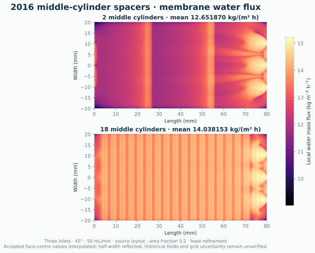

# Paper comparisons

This reference defines the methods, numerical results and limitations of the
paper comparisons. Reproduce a reported point with its specified geometry,
material inputs, spatial schemes, refinement and acceptance criteria.

| Study | Accepted evidence | Main unresolved limit |
|---|---|---|
| [2012 chambers](#2012-simulation-results) | A at 707,408 cells; B on four grids | A coarse-grid provenance; B non-monotone refinement |
| [2016 CF042](#2016-chamber-dimensions) | Reconstructed and recovered-toolkit geometries; matched persistent-coupling grids | Historical inputs and asymptotic validity |
| [2016 inlets](#2016-inlet-geometry) | Maintained- and effective-source-scheme results, reported separately | Incomplete angle/flow curves and own-grid uncertainty |
| [2016 spacers](#spacers) | Complete base-grid cylinder count curves and partial triangle curves | Middle-profile gaps, remaining counts and own-grid uncertainty |
| [High flow](#transient-integration) | Bounded startup and warm-start qualifications | No accepted 60-second settled mean or time-convergence result |
| [Channel verification](#independent-channel-refinement) | Three-grid uniform-channel study | Applies to that channel and operating point |

Useful entry points:

- [Build and installation](installation.md), [model equations](model.md) and [native GPU execution](gpu.md).
- [Recovered CF042 construction and source-scheme overrides](#original-toolkit-construction).
- [Spacer construction](#spacer-construction), [N6 refinement studies](#n6-refinement-studies), [count comparisons](#source-layout-count-comparisons) and [reproduction controls](#reproduce-the-source-layout-spacer-studies).
- [Historical reporting and geometry limitations](#historical-reporting-and-geometry-limitations).
- [Generate the figures](#generate-the-figures).

Full paper reproduction and validated uncertainty bounds remain incomplete.

### Validation method

An accepted steady result must satisfy the declared pressure targets, SIMPLE
residual limits, physical concentration bounds and integral salt-conservation
criterion. Paper comparisons require relative salt imbalance below 0.001 of
membrane transfer. Check flux stability over 100 completed iterations using
the study's reported reference controls; process exit alone is insufficient.
Independently integrate paired membrane areas, concentrations and water flux,
and verify the material coefficients and numerical dictionaries of every grid.

Initialization may use a mapped same-geometry field or temporary scalar
relaxation. Acceptance uses the specified reference controls and all original
criteria. Initialization choices and mesh checks do not establish convergence.
For spatial estimates, use effective spacing `h ∝ cells^(-1/3)` and compare
matched geometry, materials, schemes and solver accuracy. Conditional GCI fits
require a positive common order; even a successful fit needs independent
evidence of an asymptotic regime before it can be treated as an error bound.

## 2012: experimental validation and spatial polarization

Source: Gruber et al., DOI 10.3390/membranes2040764. Parameters in section 3.1:

| Parameter | Published | SI value used |
|---|---:|---:|
| A | 0.44 +/- 0.05 LMH/bar | 1.222222222222e-12 m/(Pa s) |
| B | 0.087 +/- 0.018 LMH | 2.416666666667e-8 m/s |
| K | 0.72 +/- 0.23 s/um | 720000 s/m |

Table 2 and Figures 5-7 use 1 M draw, pure-water feed, and 50 mL/min per
compartment. Simulations use half-width symmetry, so each simulated compartment
receives 25 mL/min. Molarity is converted with the concentration-dependent density.

| Chamber | Published CFD water, kg/(m2 h) | Published CFD salt, g/(m2 h) | Experimental water | Experimental salt |
|---|---:|---:|---:|---:|
| A | 5.46 | 1.35 | 5.64 +/- 0.52 | 1.44 +/- 0.28 |
| B | 5.54 | 1.37 | 5.72 +/- 0.40 | 1.60 +/- 0.39 |

The chamber generators derive from the September 2012 `createSMTCdict.py` (A)
and `createFO21Dict.py` (B). Dimensions match the published chambers; exact
identity with the publication meshes is unverified.

Chamber A uses millimetre scaling (`convertToMeters=0.001`), omits four unused
curved edges, and sets the inlet connection offset to 0.05 mm instead of
0.025 mm to avoid sliver faces.

The generators preserve the original geometry construction. Mesh assembly uses
`mirrorMesh -overwrite`, face-zone selection, and `createBaffles`. The inlet/outlet
patches are selected geometrically rather than split using hard-coded face counts.
`checkMesh` must pass before assigning fields and running a case.

### 2012 simulation results

Both geometries pass `checkMesh`. CPU results (four or eight ranks):

| Chamber | Cells (simulated half-width) | Water, kg/(m² h) | Salt, g/(m² h) | Salt imbalance / membrane transfer |
|---|---:|---:|---:|---:|
| A | 326,720 | 5.833361 | 1.436791 | 0.036% |
| A | 707,408 | 5.827270 | 1.435290 | 0.09871% |
| B | 553,560 | 5.615727 | 1.383166 | 0.08230% |
| B | 1,140,744 | 5.627176 | 1.385987 | 0.0971% |
| B | 1,926,360 | 5.628058 | 1.386204 | 0.09989% |
| B | 4,428,480 | 5.625746 | 1.385635 | 0.09378% |

On the finest accepted meshes, water flux differs from published CFD by +6.7%
(A) and +1.5% (B); salt flux differs by +6.3% and +1.1%. All four predictions
fall within the published experimental ranges. Geometry and discretization
differences prevent a direct comparison of the historical numerical fields.

The cases use linear-upwind momentum convection, van Leer salt convection,
two non-orthogonal pressure corrections, salt relaxation 0.2, and linear pressure
tolerance 1e-12. SIMPLE residual limits are 1e-6 for pressure/velocity and 1e-9
for salt, with the additional integral salt-conservation stopping condition.
Pressure/velocity relaxation is 0.15/0.3 for A and 0.3/0.7 for B.
The default Chamber A GAMG solver retains 100 cells at the coarsest pressure level and solves that level
directly. It uses DIC–Gauss–Seidel smoothing for flow initialization, then restores
the steady solver settings.
The example runner exports dictionaries, residuals, and membrane surface values
to the chosen results directory.

Small interior mass-fraction undershoots remain: minima are approximately
-4.2e-8 in the refined A case and -3.7e-8 in B, compared with a draw mass
fraction of 0.0564.
They are recorded without clipping. Membrane concentrations remain admissible.
Chamber B has four accepted meshes under the same 0.1% integral
salt-imbalance gate. Water flux changes +0.204% from the coarse to the 1.25× mesh,
and +0.01567% from the 1.25× to the 1.5× mesh. The draw-surface concentration integrals are:

| B cells | Draw-side concentration integral, m² |
|---:|---:|
| 553,560 | 1.7574121e-5 |
| 1,140,744 | 1.7645680e-5 |
| 1,926,360 | 1.7651813e-5 |
| 4,428,480 | 1.7637633e-5 |

Independent CSV integration confirms both membrane areas and integrals on all
four meshes. Refinement from 1.25× to 1.5× changes the integral by +0.03476%.
The 1.5× to 2× change is -0.04109% for water flux and
-0.08033%, reversing the previous trend. Using effective
spacing proportional to `cells**(-1/3)` and the nonuniform refinement ratios,
the first three meshes give apparent orders of about 10.2 for water flux and
9.8 for the draw integral. The fourth mesh does not support extrapolating that
monotone single-power fit; a validated asymptotic GCI remains unavailable.
On the 4,428,480-cell B mesh, accepted water fluxes at salt relaxation 0.2 and
0.3 differ by 6.6e-8 relative. The comparison and maps use the finest accepted
mesh. Chamber A grid independence and quantitative agreement with the published
spatial distributions remain unverified.

The 707,408-cell A result has relative mass imbalance 4.00e-14 and paired active
area 0.000221077433 m². Integrating 7,376 faces per side gives draw/feed
concentration integrals 1.18707864e-5 / 2.61612632e-9 m². Relative water-flux
span over 100 reference-control iterations is 8.91e-8. Its water flux is
0.1044% below the coarse result and 6.727% above published CFD. The available
coarse-grid mesh and solver provenance does not establish a consistent
three-grid sequence or GCI for A.

This refinement uses PCG/DIC, absolute 1e-12, relative 0.001 and at most
2,000 pressure iterations, with reference relaxation 0.15/0.3/0.2.

Prepare the same steady problem and set its pressure method explicitly:

```bash
case=runs/chamber-a-refined
python3 examples/run.py chamber-a "$case" --refinement 1.25 \
    --salt-imbalance 0.001 --end 60000 --setup-only
foamDictionary "$case/system/fvSolution" -entry solvers.p -set '{
    solver PCG; preconditioner DIC;
    tolerance 1e-12; relTol 0.001; maxIter 2000;
}'
foamDictionary "$case/system/fvSolution" -entry solvers.pFinal -set '{
    $p; relTol 0;
}'
```

Solve with `simpleSaltTransport` and collect with
`python3 examples/run.py chamber-a "$case" --collect-only --results runs/results/chamber-a-refined`
without regenerating the dictionaries. For parallel execution, write a
`decomposeParDict` with the desired rank count, run `decomposePar`, and use
`mpirun -np <ranks> simpleSaltTransport -parallel -case "$case"`.
The paired-surface plotter tolerates exported centre rounding while requiring
a unique face correspondence; missing or ambiguous pairs are rejected.

The [2012 paper, §2.3, Eq. (7)](https://doi.org/10.3390/membranes2040764), prints
`GCI_coarse = 3*abs(e)*R**3/(R**3 - 1)` and defines `R` as the fine/coarse
cell-count ratio. The conventional GCI uses a grid-spacing ratio and a
convergence order; in three dimensions the effective spacing ratio is
`(N_fine/N_coarse)**(1/3)`, as described in
[NASA's spatial-convergence guidance](https://www.grc.nasa.gov/www/wind/valid/tutorial/spatconv.html).
The printed definition differs from this prescription; its historical
implementation is unverified. Applying the printed cell-count formula with an
explicitly coarse-normalized concentration-integral difference gives 1.36%
for 553,560 versus 1,926,360 cells, or 0.132% for 1,140,744 versus 1,926,360 cells. These
are comparisons with the printed criterion, not validated uncertainty bounds.

The finest B configuration uses PCG with a GAMG preconditioner and the same
equations, tolerances and acceptance criteria as the coarser grids. OpenFOAM
v2606 requires these preconditioner controls in a nested dictionary:

```bash
case=runs/chamber-b-refinement-2
python3 examples/run.py chamber-b "$case" --refinement 2 --end 60000 \
    --salt-imbalance 0.001 --setup-only
foamDictionary "$case/system/fvSolution" -entry solvers.p -set '{
    solver PCG;
    preconditioner {
        preconditioner GAMG;
        smoother DICGaussSeidel;
        tolerance 1e-6;
        relTol 0.1;
        nVcycles 2;
    }
    tolerance 1e-12;
    relTol 0.001;
    maxIter 2000;
}'
cat > "$case/system/decomposeParDict" <<'EOF'
FoamFile { version 2.0; format ascii; class dictionary; object decomposeParDict; }
numberOfSubdomains 8;
method simple;
simpleCoeffs { n (8 1 1); delta 0.001; }
constraints { membranePairs { type preserveBaffles; } }
EOF
decomposePar -case "$case" > "$case/log.decomposePar" 2>&1
mpirun -np 8 simpleSaltTransport -parallel -case "$case" \
    > "$case/log.solver" 2>&1
python3 examples/run.py chamber-b "$case" --collect-only \
    --results runs/results/chamber-b-refinement-2
```

Use `--salt-imbalance 0.001` to require the stricter integral gate during
steady solving and collection. The requested limit is stored in the result
metadata and cannot be replaced by the collector’s default 1% limit.

Use `--refinement` to increase the block cell counts while preserving dimensions
and grading:

```bash
for refinement in 1 1.25 1.5 2; do
    for chamber in a b; do
        case="chamber-$chamber-refinement-$refinement"
        python3 examples/run.py "chamber-$chamber" "runs/$case" \
            --refinement "$refinement" --salt-imbalance 0.001 --ranks 8 --results "runs/results/$case"
    done
done
```

At refined port intersections, the runner checks the quarter mesh and uses
OpenFOAM's `collapseEdges` to remove identified sliver faces before mirroring.
The edge-length threshold is 10 nm; the collapse filter's minimum volume is
1e-18 m³ to accommodate the millimetre-scale channels. The assembled mesh must
still pass the standard `checkMesh` checks. Refinement factors can interact with
the legacy port intersections, so a finer mesh is not automatically a valid mesh.
Passing mesh checks alone does not establish flux or surface-field convergence.
The 2012 comparison and surface plots select the finest converged, conserved
record for each chamber at the published operating point.

Figures 5–7 are recreated as surface maps. External polarization is membrane
surface mass fraction divided by inlet draw mass fraction. Internal polarization
uses the support/active-layer interface concentration from Eq. 14, divided by
the same inlet value. Water maps show mass flux. Colour scales are independent
between chambers; consult the labelled ranges when comparing them. The plots
reflect the simulated half-width and display face-centre values without interpolation.

## 2016 chamber dimensions

Source: Gruber, Aslak & Hélix-Nielsen, DOI 10.1016/j.seppur.2015.12.017.
Figure 2 compares 5, 50 and 500 mL/min with the rectangular-channel film model,
Eqs. 4 and 9–11. Reference CFD values are transcribed from the authors' Figure 2
numerical tables in `paper_models.py`; they are benchmark inputs.

| Parameter | Value |
|---|---:|
| Membrane length / width | 85 / 39 mm |
| Channel height per compartment | 2.25 mm |
| Total compartment height | 19.25 mm |
| Inlet diameter / edge offset | 5.5 / 4.5 mm |
| Draw / feed salt mass fraction | 0.065 / 0.00065 kg/kg |
| Water permeability A | 1.61111e-12 m/(Pa s) |
| Salt permeability B | 8.33333e-8 m/s |
| Support resistance K | 150666 s/m |

The original `Jw_vs_dimensions/createPlots.py` specifies these membrane
parameters and concentrations. The concentrations also appear explicitly in the
[historical case initialization](../tests/simple3dMesh/system/setFieldsDict).
The analytical calculation uses constant diffusivity 1.45e-9 m²/s and reference
density 1000 kg/m³ for conversion to mass flux. Independent samples from the original
analytical curves agree within 0.06 kg/(m² h), the figure's digitization tolerance.
The CFD solvers retain concentration-dependent density and diffusivity.

Table 1 prints K=6.64 s/µm, which converts to 6,640,000 s/m. This conflicts with
the original plotting code and case dictionaries. It is not used for the
reference comparison: even without external concentration polarization it
limits flux to about 1.46 kg/(m² h), below the archived CFD range of 8.80–13.22.
The recovered value is 0.150666 s/µm; its reciprocal is 6.6372 µm/s, which
rounds to the table's 6.64 with inverse units. This is consistent with a
reciprocal/unit error in the table, although the original numerical inputs
do not establish how the error arose. The reference cases use those inputs
rather than fitting K to the published fluxes.

The CF042 generator uses half-width symmetry, paired membrane faces, rounded
channels and distributors, and circular ports. Each compartment receives half
the specified whole-module flow. Feed and draw enter opposite ends. The
reconstruction assumes a channel corner radius of half the inlet diameter,
distributor half-span `width/2 - diameter/2`, and distributor top height
`chamber_height - diameter/2`; a curved block transition connects it to the pipe.
These details are not uniquely specified by the published drawings. The
[original toolkit generator](https://github.com/MathiasGruber/MembraneSimKit/blob/2c4344144dadc3f2b486432724468a91652bbe3a/src/meshLibrary/setupScripts/blockCF042/meshSetup.py)
provides a separate construction with configurable corner radius, distributor
width and inlet height. Its default inlet diameter is 4.5 mm, whereas the paper
specifies 5.5 mm; toolkit defaults alone therefore do not identify the paper's
case settings. This example remains a reconstruction, and exact identity with
the original mesh is unverified.

Default tangential spacing is 0.8 mm with 24 cells through each channel and
wall-normal expansion ratio 100, giving approximately 4 µm at the membrane.
Use `--spacing 0.0004 --layers 48` for a finer grid. Every mesh must pass
`checkMesh`. Solver stopping requires salt residual below 1e-9 and salt
imbalance below 0.1% of membrane transfer. The plotter includes computed CFD points
only after convergence and conservation checks; original CFD points are always
labelled separately.

### Reconstructed CF042 results

Converged reconstructed CF042 results:

| Flow (mL/min) | Cells | Water, kg/(m² h) | Salt, g/(m² h) | Difference from archived water flux | Salt imbalance / transfer |
|---:|---:|---:|---:|---:|---:|
| 5 | 158,912 | 8.382253 | 5.392870 | −4.7% | 0.0114% |
| 50 | 158,912 | 11.180289 | 7.196734 | −1.7% | 0.0046% |
| 50 | 396,340 | 11.184071 | 7.199158 | −1.6% | <0.1000% |

Relative mass imbalance is below 4e-12. The two 50 mL/min grids differ by 0.034%
in water flux and 0.081% in the draw-surface concentration integral. These two
grids do not establish chamber grid independence, and the archived CFD
difference remains unresolved.

The recovered toolkit geometry at 50 mL/min gives the following maintained-
scheme results. Expansion is the wall-normal grading ratio; the paper's port
diameter is 5.5 mm.

| Expansion | Cells | Water, kg/(m² h) | Salt, g/(m² h) | Relative salt imbalance | Draw concentration integral, m² |
|---:|---:|---:|---:|---:|---:|
| 5 | 826,280 | 11.188519 | 7.202058 | 0.0009983 | 6.813829e-5 |
| 100 | 826,280 | 11.160097 | 7.183743 | 0.0009911 | — |
| 100 | 1,541,448 | 11.166321 | 7.187755 | 0.0009986 | 6.795666e-5 |
| 100 | 6,610,240 | 11.173889 | 7.192635 | 0.0009168 | 6.8021625e-5 |

Mass imbalance is below 1e-12. Paired areas on the three expansion-100 grids
are approximately 0.00165358, 0.00165360 and 0.00165362 m² per side.
The nominal first-cell thickness is 35.90 µm for expansion 5, 3.9611 µm on
the coarse expansion-100 grid and 2.0368 µm on its finest grid. These thicknesses
are mesh inputs, not convergence evidence. Changing grading from 5 to 100
changes coarse-grid water by −0.254% and the draw integral by −0.347%.
The expansion-5 geometry differs in topology and grading from the reconstructed
CF042 mesh, so agreement between those constructions is not a refinement study.

For the expansion-100 grids, using effective spacing proportional to the
inverse cube root of cell count gives apparent orders 1.972 for water and 2.048
for the draw integral. Richardson extrapolation gives water 11.178609
kg/(m² h); the conventional fine-grid GCI estimates, with safety factor 1.25,
are 0.0528% for water and 0.0701% for the draw integral. These are estimates
conditional on an asymptotic single-power error model, not independently
validated uncertainty bounds. Block-count rounding and grading require that
qualification. The finest computed water flux remains 1.725% below the
archived 11.37, substantially larger than the estimated discretization error;
this sequence does not close the historical-input or model discrepancy.

Initialize a refined mesh from an existing solution to reduce startup cost:

```bash
python3 examples/run.py cf042 runs/cf042-50-fine --ranks 8 \
    --spacing 0.0004 --layers 48 --initialize-from runs/cf042-50 \
    --results runs/results/cf042-50-fine
```

The source must have the same geometry and operating conditions. The runner uses
`mapFields` with the latest source time, supports decomposed sources, and resets
the coincident membrane boundary guesses before solving. This initialization
does not change the convergence or conservation requirements.
Dictionary updates retain 15-digit precision so resetting guesses preserves
the supplied material and inlet parameters.

### Original toolkit construction

Use `--cf042-geometry original` to run the recovered `blockCF042` construction:

```bash
python3 examples/run.py cf042 runs/cf042-original-50 --cf042-geometry original \
    --flow 50 --salt-imbalance 0.001 --ranks 8 \
    --results runs/results/cf042-original-50
python3 examples/run.py cf042 runs/cf042-original-50-fine --cf042-geometry original \
    --refinement 1.5 --initialize-from runs/cf042-original-50 --ranks 8 \
    --salt-imbalance 0.001 --results runs/results/cf042-original-50-fine
```

To repeat the expansion-100 refinement sequence with the same steady gates:

```bash
python3 examples/run.py cf042 runs/cf042-g100-r1 --cf042-geometry original \
    --wall-normal-expansion 100 --refinement 1 --end 60000 --ranks 4 \
    --salt-imbalance 0.001 --results runs/results/cf042-original-g100-r1
python3 examples/run.py cf042 runs/cf042-g100-r125 --cf042-geometry original \
    --wall-normal-expansion 100 --refinement 1.25 --end 60000 --ranks 4 \
    --initialize-from runs/cf042-g100-r1 --salt-imbalance 0.001 \
    --results runs/results/cf042-original-g100-r125
python3 examples/run.py cf042 runs/cf042-g100-r2 --cf042-geometry original \
    --wall-normal-expansion 100 --refinement 2 --end 60000 --ranks 4 \
    --initialize-from runs/cf042-g100-r125 --salt-imbalance 0.001 \
    --results runs/results/cf042-original-g100-r2
```

The generator preserves the source block topology, a 3 mm corner radius,
29.5 mm distributor width, 0.5 mm inlet buffer and 1 µm merge gap. Override the
first two with `--corner-radius` and `--distributor-width`. Total compartment
height remains `--chamber-height`; the intermediate inlet height is total height
minus channel height. The port diameter defaults to the paper's 5.5 mm, rather
than the toolkit's 4.5 mm. These explicit inputs must still be checked against
the case being reproduced; recovering a generator does not identify every
historical configuration.

The source quarter mesh is merged before mirroring along the length and across
the membrane. The runner splits feed/draw ports, creates paired membrane faces,
and requires `checkMesh` to pass before initializing fields. Identical duplicate
arc declarations are removed for v2606. The default full mesh contains 826,280
cells and two fluid regions. `--refinement` scales the original block counts;
`--spacing` and `--layers` apply only to the other construction. The original
channel grading ratio is 5, and its baseline contains 25 cells through each
channel. Use `--wall-normal-expansion` to test boundary-layer resolution while
preserving the geometry and cell counts. The result records the nominal first
cell height (full first-cell thickness), computed from the geometric progression.
At baseline resolution,
the nominal first cell is 35.90 µm for the source ratio 5 and 3.96 µm for ratio
100. Refinement 2 with ratio 100 gives 50 cells and a nominal 2.04 µm first cell.
These are mesh inputs, not proof of convergence. The source-default mesh needs
its own mesh-convergence study before paper-level conclusions.

Recovering the construction also does not recover every numerical setting.
The toolkit's [steady scheme template](https://github.com/MathiasGruber/MembraneSimKit/blob/2c4344144dadc3f2b486432724468a91652bbe3a/src/templatesFiles/fvSchemes_steadystate)
uses bounded upwind convection for velocity and salt, with cubic interpolation
in momentum diffusion. Its `laplacian(rhoD_AB,m_A)` cubic entry does not match
the coefficient field name `rho*D_AB` in the [archived transport equation](https://github.com/MathiasGruber/MembraneFoam/blob/e16269dccb5b154b2fe22ba61f726c35721050fb/src/solvers/simpleSaltTransport/m_AEqn.H);
that equation therefore selects the template's default linear diffusion.
The maintained examples instead use linear-upwind velocity convection and
van Leer salt convection. Numerical-scheme sensitivity must be distinguished
from geometry and material-parameter sensitivity; these archived templates
alone do not establish the settings of each published case.

On the original CF042 mesh with expansion 100, 826,280 cells and 50 mL/min,
changing only the numerical schemes gives:

| Convection / momentum diffusion | Water, kg/(m² h) | Salt, g/(m² h) | Relative salt imbalance |
|---|---:|---:|---:|
| Maintained linear-upwind / linear | 11.160097 | 7.183743 | 0.00099114 |
| Bounded upwind / linear | 11.242536 | 7.236947 | 0.00099972 |
| Maintained linear-upwind / cubic | 11.159955 | 7.183650 | 0.00044472 |
| Bounded upwind / cubic | 11.242568 | 7.236968 | 0.00099994 |

Salt convection is van Leer in the maintained rows and bounded upwind in the
upwind rows; salt diffusion remains linear in every row. All four use the same
geometry, material properties, pressure controls and relaxation. Each passes
the original residual limits, 0.1% integral salt gate, mass conservation and
physical concentration checks. Independent integration of 15,072 membrane faces
per side confirms their areas and concentration integrals. The combined schemes
increase water flux by 0.739% from the same-grid baseline and remain 1.121% below
the archived 11.37. This is scheme sensitivity on one mesh; the default-scheme
GCI above does not apply to the upwind result, and no parameter was fitted.

The matching combined-scheme grid sequence is:

| Cells | Water, kg/(m² h) | Draw-surface concentration integral, m² | Relative salt imbalance |
|---:|---:|---:|---:|
| 826,280 | 11.242568 | 6.84956946e-5 | 0.00099994 |
| 1,541,448 | 11.236259 | 6.84562460e-5 | 0.00099986 |
| 6,610,240 | 11.219007 | 6.83424425e-5 | 0.00099866 |

Every point uses matched physical inputs, effective source schemes, pressure
controls and relaxation, and passes all strict gates. The finest salt flux is
7.221747 g/(m² h), mass imbalance is 1.01e-14, and relative water span over
100 reference-control iterations is 4.92e-7. Independent integration of 15,072, 22,632 and 60,288
faces per side confirms the respective areas and concentration integrals.

Coarse-to-medium and medium-to-fine water changes are −0.05612% and
−0.15354%; the medium-to-fine draw-integral change is
−0.16624%. The finest water result remains 1.328% below archived 11.37.
The water difference ratio is 2.734, above the positive-order upper limit
2.335 for these effective-spacing ratios; the draw-integral sequence also
fails that test. Thus these three grids do not admit a positive monotone
Richardson order under the effective-spacing model. Source-scheme asymptotic
convergence and GCI remain unverified; the default-scheme estimate cannot be
transferred to this sequence. Use the reported reference settings for
reproduction.

To reproduce the effective steady-template schemes from a fresh case, prepare
the same geometry, replace convection and momentum diffusion, then solve and
collect without regenerating the dictionaries:

```bash
case=runs/cf042-source-schemes
python3 examples/run.py cf042 "$case" --cf042-geometry original \
    --wall-normal-expansion 100 --refinement 1 --flow 50 \
    --salt-imbalance 0.001 --end 60000 --setup-only
foamDictionary "$case/system/fvSchemes" -entry divSchemes -set '{
    default none;
    "div(phi,U)" bounded Gauss upwind;
    "div(phi,m_A)" bounded Gauss upwind;
    "div((mu*dev2(T(grad(U)))))" Gauss linear;
    "div((mu*dev2(grad(U).T())))" Gauss linear;
}'
foamDictionary "$case/system/fvSchemes" -entry laplacianSchemes -set '{
    default Gauss linear corrected;
    "laplacian(mu,U)" Gauss cubic corrected;
}'
simpleSaltTransport -case "$case" > "$case/log.solver" 2>&1
python3 examples/run.py cf042 "$case" --collect-only \
    --results runs/source-scheme-results/cf042
```

For the separate comparisons, omit the momentum-diffusion override or the
convection override, respectively. Keep these outputs separate from the
default-scheme grid study. Collected results retain the actual dictionaries.

Both constructions use the same membrane equations, material properties and
whole-module flow convention. Warm starts require matching construction and
geometry parameters. Collected results record the source revision and inputs;
the dimension plot distinguishes original-toolkit results with separate open
markers and the grading ratio in the legend. Reconstructed geometry uses open
diamonds. Grid selection remains separate for each construction and grading ratio.
Runs with nondefault corner radius or distributor width are excluded from that
reference plot. Mesh quality and startup checks do not establish a converged paper flux or
grid independence.

### Recovered CF042 port and distributor inputs

At 50 mL/min, expansion 100 and 826,280 cells, the same effective-source
schemes also converge with the independently recovered port/offset inputs:

| Port diameter, mm | Distributor offset, mm | Water, kg/(m² h) | Salt, g/(m² h) | Relative salt imbalance | Archived water gap |
|---:|---:|---:|---:|---:|---:|
| 4.5 | 4.25 | 11.290783 | 7.267993 | 0.00099993 | −0.6967% |
| 4.5 | 4.50 | 11.297444 | 7.272302 | 0.00099980 | −0.6381% |
| 5.5 | 4.25 | 11.239456 | 7.234948 | 0.00099996 | −1.148% |

The 5.5 mm / 4.50 mm same-grid baseline is 11.242568. The 4.5 mm port and
4.25 mm offset come from the recovered generator; the paper reports different
inputs. Historical per-case inputs remain unverified, and closer agreement
alone does not identify them. These geometry-input studies are separate from
the matching-grid sequences above; their own grid uncertainty remains open.

The port/offset results have relative mass imbalance below 3e-14 and paired
area 0.001653579065 m². Their draw-side concentration integrals are
6.89334811e-5, 6.89730561e-5 and 6.84814820e-5 m²; feed-side integrals are
2.23134471e-6, 2.22500380e-6 and 2.23844482e-6 m², respectively.
Relative water spans over 100 reference-control iterations are below 1.25e-7.

For the recovered 4.5 mm / 4.25 mm inputs, refinement 1.25 has 1,541,448 cells,
water 11.284585 kg/(m² h), salt 7.263986 g/(m² h), relative salt imbalance
1.0464e-5 and mass imbalance 2.09e-15. Its paired area is 0.001653596803 m²,
with draw/feed concentration integrals 6.8897309604e-5 / 2.2360404753e-6 m².
Water changes −0.05489% from the coarse grid and is 0.7512% below archived 11.37.
These two grids match geometry, materials and numerical controls but do not
establish a convergence order. No accepted 6,610,240-cell result is available
for this pressure/velocity/salt-relaxation 0.3/0.7/0.3 configuration; pressure
accuracy and physical bounds alone are insufficient for acceptance.

Prepare a selected row using its explicit inputs, then apply the
effective-source scheme overrides above. For the recovered generator defaults:

```bash
case=runs/cf042-source-inputs
python3 examples/run.py cf042 "$case" --cf042-geometry original \
    --wall-normal-expansion 100 --inlet-diameter 0.0045 --offset 0.00425 \
    --flow 50 --salt-imbalance 0.001 --setup-only
```

Use GAMG with `tolerance 1e-12`, `relTol 0.001` and
`smoother DICGaussSeidel`, retaining pressure/velocity/salt relaxation
0.3/0.7/0.3. Solve and collect without regenerating dictionaries, as in the
source-scheme recipe. No membrane parameter is fitted to the archived flux.

A separate sequence retains recovered pressure/velocity/salt relaxation
1/0.5/0.9 and eight nonorthogonal corrections through strict acceptance,
with tight pressure targets. Matching these controls on all four meshes
passes the original residual, physical and integral-conservation gates:

| Refinement | Cells | Water, kg/(m² h) | Salt, g/(m² h) | Relative salt imbalance | Draw concentration integral, m² |
|---|---:|---:|---:|---:|---:|
| 1 | 826,280 | 11.291004 | 7.268137 | 9.58e-6 | 6.89340808e-5 |
| 1.25 | 1,541,448 | 11.284712 | 7.264069 | 6.62e-5 | 6.88978908e-5 |
| 1.5 | 2,920,000 | 11.276978 | 7.259071 | 1.24e-4 | 6.88496096e-5 |
| 2 | 6,610,240 | 11.269857 | 7.254471 | 9.9978e-4 | 6.88052491e-5 |

All four persistent-coupling grids use identical `fvSolution`, `fvSchemes` and
material dictionaries. Relative mass imbalance is below 1.18e-14, and water
spans over 100 reference-control iterations are below 6.71e-7. The finest
paired area is 0.001653622628 m², with feed concentration integral 2.24575020e-6 m².
These controls define a separate study from the 0.3/0.7/0.3 sequence.

Refinement 1.5→2 changes water by −0.06315% and the draw integral by
−0.06443%; fine water remains 0.88077% below archived 11.37. Under effective
spacing `h ∝ cells^(-1/3)`, the finest three grids admit conditional orders
1.36368 for water and 1.37213 for the draw integral, with fine-grid GCIs
0.17561% and 0.17787%, respectively. The coarsest three grids admit no positive
order. The 1/1.25/2 grid selection also fails that test: its difference
ratios 0.42355/0.39064 are below the positive-order limit 0.42829. Dependence
on the chosen grid window prevents an independently validated asymptotic
claim. Strong grading, block rounding and historical per-case inputs remain
unresolved; the conditional estimates do not explain the archived flux gap.

The finest-three water estimate is reproducible with the public calculator:

```bash
PYTHONPATH=examples python3 - <<'PY'
from membranefoam.results import effective_grid_estimate
print(effective_grid_estimate(
    [1541448, 2920000, 6610240],
    [11.2847121848, 11.2769775418, 11.2698566087],
))
PY
```

For this persistent-coupling variant, prepare the recovered geometry with
`--refinement 1`, `1.25`, `1.5` or `2`, apply the effective-source schemes, and use
these controls instead of restoring 0.3/0.7/0.3:

```bash
for field in p pFinal; do
    foamDictionary -precision 15 "$case/system/fvSolution" -entry "solvers.$field" \
        -set '{ solver GAMG; tolerance 1e-12; relTol 0.001; smoother DICGaussSeidel; maxIter 2000; }'
done
foamDictionary "$case/system/fvSolution" -entry SIMPLE.nNonOrthogonalCorrectors -set 8
foamDictionary "$case/system/fvSolution" -entry relaxationFactors.fields.p -set 1
foamDictionary "$case/system/fvSolution" -entry relaxationFactors.equations.U -set 0.5
foamDictionary "$case/system/fvSolution" -entry relaxationFactors.equations.m_A -set 0.9
foamDictionary "$case/system/fvSolution" -entry SIMPLE.residualControl.m_A -set 1e-9
```

Retain `SIMPLE.maxRelativeSaltImbalance 0.001`, pressure/velocity residual
limits 1e-6 and all physical and mass-balance criteria. The persistent
relaxation factors are part of the accepted numerical configuration.

## 2016 inlet geometry

The `3dblock` example generates the 80 × 40 mm chamber with a 2 mm channel
on each side of the membrane. Its rounded ends and 1 mm rectangular ports
follow the [archived quarter mesh](../tests/simple3dMesh/constant/polyMesh/blockMeshDict).
`--inlets` selects an odd whole-width count from 1 to 19; `--angle` selects
0–90° relative to the membrane. The default is three inlets at 45° and
50 mL/min. Feed and draw flow in opposite directions, with half-width symmetry.
The membrane parameters and concentrations are those listed above.

```bash
python3 examples/run.py 3dblock runs/block-3 --inlets 3 --angle 45 --ranks 8
python3 examples/run.py 3dblock runs/block-3-fine --inlets 3 --angle 45 \
    --refinement 1.25 --ranks 8
```

The port axes rotate about a point 0.5 mm toward the inlet from the rounded-end centre
and 0.5 mm above the membrane. Port faces meet the curved chamber wall directly.
The mesh partitions that wall at both port lips, avoiding thin cut cells.
`--refinement` increases cell counts in every direction while retaining the
geometry and wall-normal grading. Each generated mesh must pass `checkMesh`.
A passing mesh establishes numerical quality; agreement with the published
inlet-count and angle curves requires converged, mesh-resolved solutions.

Generate inlet-angle and inlet-count comparisons with the same runner:

```bash
for angle in 0 45 90; do
    python3 examples/run.py 3dblock "runs/inlet-angle-$angle" --angle "$angle" \
        --ranks 8 --results "runs/results/inlet-angle-$angle"
done
for count in 1 7; do
    python3 examples/run.py 3dblock "runs/inlet-count-$count" --inlets "$count" \
        --ranks 8 --results "runs/results/inlet-count-$count"
done
python3 examples/plot.py --results runs/results
```

The plotter writes `2016-inlets.svg` when eligible inlet-study results exist.
Filled circles are the authors' numerical reference tables; open diamonds are
computed solutions. It selects the finest accepted mesh at each operating point,
excludes spacer and transient cases, and requires salt imbalance below 0.1%
of membrane transfer. Use `--flow` to repeat the studies at 5 and 500 mL/min.

### Maintained-scheme inlet results

At 50 mL/min, the accepted three-inlet solutions are:

| Angle | Cells | Water flux, kg/(m² h) | Archived flux | Salt imbalance |
| --- | ---: | ---: | ---: | ---: |
| 30° | 1,066,000 | 12.018934 | 11.90 | 0.09996% |
| 45° | 1,066,000 | 11.897860 | 11.90 | 0.09814% |
| 50° | 1,066,000 | 11.861254 | 11.90 | 0.09912% |
| 60° | 1,066,000 | 11.823157 | 11.89 | 0.09790% |
| 70° | 1,030,800 | 11.817270 | 11.89 | 0.03199% |
| 80° | 1,014,800 | 11.793435 | 11.89 | 0.08206% |
| 90° | 1,014,800 | 11.758823 | 11.89 | 0.04556% |

Salt imbalance is relative to membrane transfer; relative mass imbalance is
below 5e-12 for every listed case. The accepted 45°, 50 mL/min inlet-count points are:

| Inlet count | Cells | Water flux, kg/(m² h) | Archived flux | Salt imbalance |
| --- | ---: | ---: | ---: | ---: |
| 5 | 1,078,476 | 11.810781 | 11.91 | 0.00176% |
| 7 | 1,080,400 | 11.776103 | 11.92 | 0.00945% |
| 9 | 1,087,600 | 11.765107 | 11.92 | 0.09999% |
| 11 | 1,084,248 | 11.755738 | 11.92 | 0.04414% |
| 15 | 1,109,200 | 11.739117 | 11.92 | 0.07290% |

Their relative mass imbalances are 1.5e-12, 3.0e-12, 5.6e-12, 2.5e-12, and
1.7e-12. The fluxes lie 0.8% to 1.5% below the archived values, with the offset
growing from five to fifteen inlets.

### Effective source-scheme inlet studies

A separate three-inlet, 45°, 50 mL/min grid sequence uses the effective
source-template schemes: bounded upwind velocity/salt convection, cubic momentum
diffusion and linear salt diffusion:

| Refinement | Cells | Water, kg/(m² h) | Draw-surface concentration integral, m² | Relative salt imbalance |
|---:|---:|---:|---:|---:|
| 1 | 1,066,000 | 11.973892 | 7.20449638e-5 | 0.00099909 |
| 1.25 | 2,288,976 | 11.973458 | 7.20430071e-5 | 0.00099894 |
| 1.5 | 3,698,800 | 11.968144 | 7.19991087e-5 | 1.04e-9 |

All three match physical inputs, schemes and reference controls and pass the
strict acceptance gates. Independent integration of 25,600, 41,328 and 58,394
faces per side confirms both 0.0016 m² areas and concentration integrals.
The finest salt flux is 7.704905 g/(m² h) and mass imbalance is 5.46e-14.
Pressure uses GAMG/DIC–Gauss–Seidel, absolute tolerance 1e-11 and relative
tolerance 0.001; pressure/velocity/salt relaxation is 0.3/0.7/0.3.
The finest-grid water span over 100 reference-control iterations is below
the printed precision.

Coarse-to-medium and medium-to-fine water changes are −0.003620% and
−0.044385%; the medium-to-fine draw-integral change is
−0.060934%. The water difference ratio, 12.262, exceeds the positive-order upper
limit 0.628 for effective-spacing ratios 1.2901 and 1.1735. Thus these grids do
not admit a positive monotone Richardson order under that spacing model, and
asymptotic convergence and GCI remain unverified. The finest water result is
0.573% above archived 11.90. Close agreement of the maintained-scheme coarse
result does not eliminate numerical-scheme sensitivity.

To reproduce this sequence, prepare the refined case above with the desired
`--refinement 1`, `1.25` or `1.5` and
`--salt-imbalance 0.001 --setup-only`, apply the
[effective source-scheme overrides](#original-toolkit-construction), set the
pressure smoother to `DICGaussSeidel`, then solve and collect without regenerating
the dictionaries. Keep these scheme-study outputs separate from the
default inlet comparisons.

The 45°, 50 mL/min effective-source inlet-count results use PCG/DIC pressure
with absolute tolerance 1e-12, relative tolerance zero, maximum 2,000 iterations
and pressure/velocity/salt relaxation 0.3/0.7/0.3:

| Inlets | Cells | Water, kg/(m² h) | Salt, g/(m² h) | Archived water | Difference | Relative salt imbalance |
|---:|---:|---:|---:|---:|---:|---:|
| 5 | 1,078,476 | 11.895036 | 7.657779 | 11.91 | −0.1256% | 1.06e-6 |
| 7 | 1,080,400 | 11.863783 | 7.637633 | 11.92 | −0.4716% | 3.72e-6 |
| 9 | 1,087,600 | 11.848952 | 7.628072 | 11.92 | −0.5960% | 5.37e-6 |
| 11 | 1,084,248 | 11.836333 | 7.619937 | 11.92 | −0.7019% | 6.80e-6 |
| 13 | 1,117,828 | 11.824142 | 7.612076 | 11.92 | −0.8042% | 0.00099728 |
| 17 | 1,105,848 | 11.799573 | 7.596237 | 11.92 | −1.010% | 0.00099891 |
| 19 | 1,123,600 | 11.787408 | 7.588395 | 11.91 | −1.029% | 0.00099897 |

All paired membrane areas are 0.0016 m² per side. Relative mass imbalance is
below 4.40e-13; water spans over 100 reference-control iterations are below
6.83e-7. Material properties and spatial schemes match across these counts.
The results are separate from the maintained-scheme table and lack independent
own-grid uncertainty estimates. Use the selected inlet count in this recipe:

Prepare a fresh 17-inlet case, apply the effective source-scheme
`foamDictionary` overrides above to this case, then set both pressure entries:

```bash
case=runs/block-17-source-schemes
python3 examples/run.py 3dblock "$case" --inlets 17 --angle 45 --flow 50 \
    --salt-imbalance 0.001 --end 60000 --setup-only
# Apply the source-scheme divSchemes and laplacianSchemes overrides here.
for entry in solvers.p solvers.pFinal; do
    foamDictionary "$case/system/fvSolution" -entry "$entry" -set '{
        solver PCG; preconditioner DIC;
        tolerance 1e-12; relTol 0; maxIter 2000;
    }'
done
```

Run `simpleSaltTransport` and collect without regenerating the dictionaries,
as in the source-scheme recipe. Acceptance requires every declared residual,
physical and conservation criterion.

The maintained-scheme 13-inlet case has no accepted result: its salt-equation
residual plateau is about 5e-9 against a 1e-9 criterion, despite passing the
salt-balance criterion. Its water diagnostic, 11.747419 kg/(m² h), is excluded
from the accepted comparison.

At 5 mL/min, the accepted three-inlet, 45° solution gives a water flux of
9.153626 kg/(m² h) on the 1,066,000-cell grid (salt imbalance 0.09956% of
membrane transfer, relative mass imbalance 3.0e-13). The archived 5 mL/min
reference values at 40° and 50° are 9.47 and 9.46 kg/(m² h), so this point
lies 3.3% below the archived reference level, a larger offset than the
50 mL/min points above.
A separate three-inlet, 40°, 5 mL/min effective-source study converges on
1,066,000 cells at water 9.261012 kg/(m² h) and salt 5.959417 g/(m² h).
Relative salt imbalance is 2.12e-8 and mass imbalance is 1.03e-13.
Independent integration of 25,600 faces per side confirms both 0.0016 m² areas
and draw/feed concentration integrals 5.19838317e-5 / 2.90853866e-6 m².
Water is 2.207% below the archived 40° value 9.47. This source-scheme point
remains separate from the maintained-scheme inlet comparisons, with its own
grid-convergence estimate still unverified.

The source-scheme low-flow configuration uses pressure/velocity/salt relaxation
0.3/0.7/0.3 and PCG/DIC pressure at absolute tolerance 1e-12, relative zero.
Its water span over 100 reference-control iterations is 2.16e-12 relative.

To reproduce the same steady problem from fresh initialization, use
`--inlets 3 --angle 40 --flow 5 --salt-imbalance 0.001 --setup-only`, apply the
effective-source overrides and PCG/DIC settings in the inlet recipe above,
then solve and collect without regenerating dictionaries.

The maintained-scheme 10° result is excluded because its relative salt imbalance
plateaus at 0.001145, above the 0.001 criterion; its water diagnostic is
12.197 kg/(m² h). No accepted 0° result is available because membrane salt
concentrations violate physical bounds. These exclusions leave the corresponding
archived angle points unreproduced.

These points do not establish grid independence or reproduce
the complete inlet studies. At 50 mL/min and 45°, the plotter also writes
membrane-field maps for each accepted inlet count.
The 3dBlock runner uses a linear pressure tolerance of 1e-11 and relative
tolerance of 0.001. This avoids driving GAMG below the attainable residual on
the graded inlet meshes. Residual convergence and the 0.1% salt-conservation
requirement must both pass before a result is accepted.

## Spacers

### Spacer construction

`--spacers` adds an even number of transverse spacers, uniformly spaced along
each channel. Their mesh segments lie at longitudinal positions `length * i / (count + 1)`.
The default `--spacer-placement middle` centres the shape between the membrane
and opposite wall. `up` places it against the outer wall, `down` against the
membrane, and `changing` alternates Down/Up within the length-quarter, then
mirrors that sequence. For six spacers the full order is Down/Up/Down/Down/Up/Down;
it is not strict full-length alternation. At two spacers, Changing and Down
produce the same arrangement. The spacers span
the full width. `--spacer-radius` is an explicit reconstruction parameter. The
[original toolkit configuration](https://github.com/MathiasGruber/MembraneSimKit/blob/2c4344144dadc3f2b486432724468a91652bbe3a/src/meshLibrary/setupScripts/3dBlock/configFile.py)
defines spacer cross-sectional area as `spacerVolume * height²`, with default
`spacerVolume=0.2`. At a 2 mm channel height, this gives a middle-cylinder radius
of 0.504627 mm. `--spacer-area-fraction 0.2` selects that area directly;
`--spacer-shape triangle` uses an equilateral triangle with the same area.
Its vertical base faces increasing x and its centroid lies at mid-height,
matching the source middle-triangle orientation. The defaults provide a
reproducible alternative to the 0.5 mm example below, but are not evidence
of the paper-specific configuration.

```bash
python3 examples/run.py 3dblock runs/block-2-spacers --spacers 2 \
    --spacer-radius 0.0005 --ranks 8
```

For this example radius of 0.5 mm, each cylinder displaces
`π * radius² * width` of fluid per compartment. The mesh grades toward both
the cylinder and channel walls. Use `--refinement` to test spatial convergence
and vary the radius to assess geometric sensitivity. These are reconstructed
middle-spacer cases. The equilateral triangle retains its straight sides and
sharp corners in a conformal mesh; its side length is
`sqrt(4 * area_fraction * height² / sqrt(3))`. This changes the spacer geometry
without importing the legacy inlet mesh or its cell grading. Cylinder and
triangle comparisons should use the same explicit cross-sectional area and
independently converged grids. Wall-contact geometry follows the recovered source boundary construction,
with conformal transitions matching the neighbouring channel cells. The
truncated wall cylinder retains area `(3π/4 + 1/2) * radius²`; an equal-area
wall cylinder therefore has a different radius from a middle cylinder.
Streamwise placement is explicit. The default `--spacer-layout uniform` retains
uniform centre spacing; `--spacer-layout source` recovers the toolkit's
[linker-spacing construction](https://github.com/MathiasGruber/MembraneSimKit/blob/2c4344144dadc3f2b486432724468a91652bbe3a/src/meshLibrary/setupScripts/3dBlock/meshSetup.py).
For `n` spacers in the half-length mesh, channel length `L` and height `H`,
its gap is `(L/2 - n*H - H)/(n+1) * (1 + 0.5/(n+1))`. The centre of spacer
`i` is `i*(gap+H) + H/2`; the second half mirrors those positions. With six
spacers in the full 80 mm channel, the recovered centres are 12, 23, 34, 46,
57 and 68 mm from one end. Result metadata records both the layout and all
centres. This recovers longitudinal positions while retaining the maintained
inlet and spacer-block discretization; it does not identify every historical
case setting or establish flux agreement.

```bash
python3 examples/run.py 3dblock runs/block-source-layout --spacers 6 \
    --spacer-area-fraction 0.2 --spacer-layout source --salt-imbalance 0.001 \
    --setup-only
```

Two uniform-layout, six-spacer cases converge with effective source-template
schemes, area fraction 0.2, three inlets at 45° and 50 mL/min:

| Shape / placement | Cells | Water per active area, kg/(m² h) | Water per nominal area, kg/(m² h) | Salt, g/(m² h) | Relative salt imbalance | Difference from archived water flux |
|---|---:|---:|---:|---:|---:|---:|
| Cylinder / Middle | 4,178,800 | 13.265341 | 13.265341 | 8.541417 | 0.00099920 | +3.270% |
| Triangle / Down | 3,048,400 | 13.339187 | 11.979355 | 8.589062 | 0.00099787 | +0.9084% |

Mass imbalance is below 9e-13 in both cases. Independent integration of 69,200
and 72,800 faces per side confirms active areas of 0.0016 and 0.001436892 m²
per simulated half-width compartment, respectively, and the concentration
integrals. The triangle contacts the membrane and leaves 89.806% of its nominal
area permeable. The boundary diagnostic averages over the active patch, matching
the recovered source diagnostic; multiplying by the active/nominal area ratio
reports the nominal-area equivalent. These two means must be distinguished when
assessing total water transfer. The triangle's higher active-area mean alone
does not establish greater module production than the middle cylinder.

### N6 placement and source-layout studies

The archived six-spacer means are 12.8453 for the Middle cylinder and
13.2191 for the Down triangle. The source-layout results at the same physical
inputs and effective source schemes are:

| Shape / placement | Cells | Water per active area, kg/(m² h) | Water per nominal area, kg/(m² h) | Salt, g/(m² h) | Relative salt imbalance | Difference from archived water flux |
|---|---:|---:|---:|---:|---:|---:|
| Cylinder / Middle | 4,162,000 | 13.271754 | 13.271754 | 8.545552 | 0.00099858 | +3.320% |
| Triangle / Down | 3,031,600 | 13.342594 | 11.982415 | 8.591258 | 0.00099915 | +0.9342% |
| Triangle / Middle | 4,450,000 | 13.413654 | 13.413654 | 8.637064 | 0.00099909 | +4.711% |
| Cylinder / Up | 3,211,600 | 12.783960 | 12.783960 | 8.230980 | 0.00099903 | +1.311% |
| Cylinder / Down | 3,053,200 | 13.162448 | 12.423585 | 8.475084 | 0.00099868 | +0.4407% |
| Cylinder / Changing | 3,106,000 | 13.084957 | 12.595282 | 8.425113 | 0.00099769 | +0.4449% |
| Triangle / Up | 3,031,600 | 12.836248 | 12.836248 | 8.264714 | 0.00099882 | +0.8030% |
| Triangle / Changing | 3,031,600 | 13.228716 | 12.329669 | 8.517822 | 0.00099699 | +0.8279% |
| Triangle / Middle, source anchor | 4,466,800 | 13.412756 | 13.412756 | 8.636485 | 3.86e-9 | +4.704% |
| Triangle / Down, refinement 1.25 | 6,466,128 | 13.334482 | 11.975130 | 8.586028 | 3.86e-11 | +0.8728% |
| Cylinder / Middle, refinement 1.25 | 9,090,960 | 13.170556 | 13.170556 | 8.480288 | 0.00099845 | +2.532% |

For the first two rows, mass imbalances are 4.09e-13 and 7.49e-13. Independent
integration of 68,800 and 72,400 faces per side confirms the respective active
areas of 0.0016 and 0.001436892 m² and both concentration integrals. Physical inputs, effective
source schemes, pressure controls and relaxation match their uniform-layout
counterparts. Water increases only 0.04834% and 0.02554%, respectively, so
recovered linker positions alone do not explain the archived discrepancies.
These layout comparisons are separate from grid convergence and do not prove
the paper results wrong.

The centred Middle triangle has paired area 0.0016 m² and draw/feed
concentration integrals 8.44482401e-5 / 1.51391980e-6 m². Its ranking relative
to the Middle cylinder differs from the archive, but grid uncertainty prevents
a physical shape-advantage conclusion.

Linker spacing and profile anchoring are distinct geometry inputs. The toolkit's
[middle triangle](https://github.com/MathiasGruber/MembraneSimKit/blob/2c4344144dadc3f2b486432724468a91652bbe3a/src/meshLibrary/setupScripts/3dBlock/spacers/Triangle.py)
places its upstream tip 0.1 channel heights from the envelope's left edge.
Its centroid is therefore `0.1 H + 2 triangleHeight / 3` from that edge, while
the centred reconstruction uses `H / 2`. For area fraction 0.2 and H = 2 mm,
the source position is 15.245 µm upstream. Wall triangles already retain the
source's internal anchoring and need no additional shift.

`--spacer-profile-offset` translates each quarter's profiles before mirroring;
the default zero preserves the comparisons above. Metadata records this offset
and the translated construction centres. An independent source-anchor study
uses `--spacer-layout source --spacer-shape triangle --spacer-placement middle
--spacer-area-fraction 0.2 --spacer-profile-offset=-1.52450782979e-5`.
The offset is derived from source geometry rather than fitted to flux. Geometry
tests verify its triangle vertices. The source-anchored result has paired area
0.0016 m², draw/feed concentration integrals 8.44399584e-5 / 1.51412884e-6 m²,
relative salt imbalance 3.86e-9 and mass imbalance 8.68e-15.

The shift changes water by −0.006694% from the centred case, leaving a +4.704%
archived gap. The generated mesh changes from 4,450,000 to 4,466,800 cells;
this comparison includes that block-count change, so it does not isolate a
pure position effect at fixed discretization. Actual membrane A/B/K
coefficients match the centred case. The middle-triangle ranking relative to
the middle cylinder remains different from the archive; own-grid convergence
is still unverified.

The N6 wall-placement membrane areas and concentration integrals are:

| Shape / placement | Active area, m² | Draw integral, m² | Feed integral, m² |
|---|---:|---:|---:|
| Cylinder / Up | 0.0016 | 7.87830221e-5 | 1.68369437e-6 |
| Cylinder / Down | 0.001510185315 | 7.75256493e-5 | 1.48674281e-6 |
| Cylinder / Changing | 0.001540123544 | 7.83909060e-5 | 1.53565833e-6 |
| Triangle / Up | 0.0016 | 7.92358661e-5 | 1.66516302e-6 |
| Triangle / Changing | 0.001491261168 | 7.70928575e-5 | 1.44869911e-6 |

Relative mass imbalance is below 7.36e-13 and water spans over 100 reference-
control iterations are below 4.86e-7. Up placements leave the membrane fully
permeable. The corrected wall-cylinder radius is 0.529238 mm. Down cylinder
and Changing cylinder retain 94.387% and 96.258% of nominal area; Changing
triangle retains 93.204%. Their nominal-area fluxes are reported in the table
above. Historical per-case inputs and these profiles' own-grid uncertainties
remain unresolved; radius sensitivity is documented separately below.

### N6 refinement studies

#### Middle triangle

The three source-anchored grids use matched geometry, materials, spatial schemes
and pressure accuracy/coupling controls:

| Refinement | Cells | Water, kg/(m² h) | Draw-surface concentration integral, m² |
|---:|---:|---:|---:|
| 1 | 4,466,800 | 13.4127559816 | 8.44399584e-5 |
| 1.25 | 9,824,784 | 13.3384290451 | 8.37606383e-5 |
| 1.5 | 15,565,424 | 13.2918264814 | 8.33354968e-5 |

The refinement-1.25 result has salt flux 8.588550 g/(m² h), relative salt
imbalance 0.000995942 and paired area 0.0016 m². The finest result has salt
flux 8.558496 g/(m² h), salt imbalance 0.0009999753 and mass imbalance 5.07e-14.
Its draw/feed concentration integrals are 8.33354968e-5 / 1.54618246e-6 m²,
and its relative water span over 100 reference-control iterations is 1.01e-7.
An explicit finest-grid pressure cap of 2,000 is inactive; the largest observed
pressure iteration count across the grids is 25.

The medium-to-fine changes are −0.349386% for water and −0.507567% for the
draw integral, leaving water +3.7597% above archived 12.8102. With effective
spacing `N^(-1/3)`, difference ratios 1.594911 and 1.597869 are below the
zero-order limit 1.713021. Neither sequence admits a positive common power-law
order, so these monotone values do not establish an asymptotic regime or GCI.

#### Down triangle

The Down-triangle grids share physical inputs, membrane coefficients, spatial
schemes and the full reference `fvSolution`. Active membrane area is
0.001436891752 m². At refinement 1.25, nominal-area water is 11.975130 kg/(m² h),
salt is 8.586028 g/(m² h), salt imbalance is 3.86e-11 and mass imbalance is
1.51e-14. At refinement 1.5, nominal-area water is 11.971652, salt is 8.583532,
salt imbalance is 0.000999081 and mass imbalance is 1.90e-13. The finest
draw/feed concentration integrals are 7.51087522e-5 / 1.37174620e-6 m²;
relative water span over 100 reference-control iterations is 1.45e-8.

| Cells | Water / active area, kg/(m² h) | Draw concentration integral, m² |
|---:|---:|---:|
| 3,031,600 | 13.3425941415 | 7.52017010120e-5 |
| 6,466,128 | 13.3344821387 | 7.51385348208e-5 |
| 10,518,256 | 13.3306096104 | 7.51087522137e-5 |

For these three grids, fitting `f(h) = f0 + C h^p` with effective spacing
`h ∝ N^(-1/3)` gives apparent orders 1.4161 for water and 1.4747 for the
draw integral. With safety factor 1.25, the conditional fine-grid GCIs are
0.14065% and 0.18345%, respectively. This follows the effective-spacing and
safety-factor conventions in the
[NASA grid-convergence tutorial](https://www.grc.nasa.gov/www/wind/valid/tutorial/spatconv.html).
The last refinement changes water −0.02904% and the draw integral −0.03964%,
leaving water +0.84355% above archived 13.2191. Strong grading and blockwise
count rounding leave the common power-law and asymptotic-range assumptions
unverified; these fitted estimates are not validated total error bounds and
do not transfer to other spacer profiles or counts.

`effective_grid_estimate` reproduces the conditional calculation and rejects
non-monotone sequences or those with no positive effective-spacing order:

```bash
PYTHONPATH=examples python3 - <<'PY'
from membranefoam.results import effective_grid_estimate
print(effective_grid_estimate(
    [3031600, 6466128, 10518256],
    [13.3425941415, 13.3344821387, 13.3306096104],
))
PY
```

#### Middle cylinder

The Middle-cylinder grids share zero profile offset, physical geometry,
materials, spatial schemes and pressure accuracy/coupling controls. Paired
membrane area is 0.0016 m². The refinement-1.25 result has salt flux 8.480288
g/(m² h), salt imbalance 0.00099845 and mass imbalance 9.38e-15. The finest
result has salt flux 8.442822, salt imbalance 0.00099838 and mass imbalance
1.77e-13. Its draw/feed concentration integrals are
8.16951561e-5 / 1.59485141e-6 m², and its water span over 100 reference-control
iterations is 1.23e-7.

| Cells | Water / active area, kg/(m² h) | Draw concentration integral, m² |
|---:|---:|---:|
| 4,162,000 | 13.2717539167 | 8.31299972302e-5 |
| 9,090,960 | 13.1705564834 | 8.22158878695e-5 |
| 14,448,112 | 13.1124616894 | 8.16951561204e-5 |

The finest configuration has an explicit pressure cap of 2,000; the largest
observed pressure iteration count across the three grids is 22, so that cap
is inactive.

Using the same effective-spacing model and safety factor as above gives very
low apparent orders: 0.1560 for water and 0.1931 for the draw integral.
Conditional fine-grid GCIs are correspondingly large, 22.72% and 26.33%.
The last refinement changes water −0.44110% and the draw integral −0.63337%,
leaving water +2.07984% above archived 12.8453. The nearly zero orders make
extrapolation ill-conditioned; these fits do not establish an asymptotic
regime or a validated uncertainty bound. The remaining archived difference
cannot be assigned to model or paper error from this fit.

### Source-layout count comparisons

The two-spacer source-layout results use area fraction 0.2 and effective
source schemes at three inlets, 45° and 50 mL/min. Water units are
kg/(m² h), salt units g/(m² h):

| Shape / placement | Cells | Water per active area | Water per nominal area | Salt | Relative salt imbalance |
|---|---:|---:|---:|---:|---:|
| Cylinder / Middle | 3,240,400 | 12.651870 | 12.651870 | 8.145797 | 1.35e-10 |
| Cylinder / Up | 2,923,600 | 12.351672 | 12.351672 | 7.952208 | 1.83e-10 |
| Cylinder / Down | 2,870,800 | 12.717752 | 12.479785 | 8.188302 | 8.92e-11 |
| Triangle / Middle, source anchor | 3,353,200 | 12.733226 | 12.733226 | 8.198266 | 2.08e-9 |
| Triangle / Up | 2,863,600 | 12.369199 | 12.369199 | 7.963519 | 9.57e-12 |
| Triangle / Down | 2,863,600 | 12.790318 | 12.355692 | 8.235095 | 6.04e-10 |

The original Figure 7 plotting inputs provide the following two-spacer
references. These are numerical tables, rather than values digitized from
the figure. The author's plotting script labels its `Sphere_*` inputs as
Cylinder and its `vol` coordinate as the number of spacers. Differences below
compare computed active-area means with archived plotted means;
historical per-case area normalization and numerical settings remain unverified.

| Shape / placement | Archived water | Computed difference |
|---|---:|---:|
| Cylinder / Middle | 12.35 | +2.444% |
| Cylinder / Up | 12.2152 | +1.117% |
| Cylinder / Down | 12.6271 | +0.718% |
| Cylinder / Changing | 12.63 | +0.695% |
| Triangle / Middle | 12.3266 | +3.299% |
| Triangle / Up | 12.2786 | +0.738% |
| Triangle / Down | 12.6718 | +0.935% |
| Triangle / Changing | 12.6735 | +0.922% |

At two spacers, Changing has the same geometry as Down for each shape.
The generator produces byte-identical mesh dictionaries, initial fields and
material files, so the Down point also represents Changing without a duplicate
solve. Middle triangle uses the derived −15.245 µm quarter offset. Wall
cylinders retain the corrected equal-area radius. The Down cylinder and
triangle leave 98.12886% and 96.60191% of nominal membrane area permeable;
their active-area means require those factors when comparing module transfer.
The archived Down and Changing means differ slightly despite that geometric
equivalence. Their separate historical grids and stopping states are unavailable,
so the difference does not establish a geometry or paper error.

The six unique two-spacer cases have relative mass imbalance below 3.36e-14.
Their paired-surface integrals and 100-iteration reference-control stability
checks satisfy the validation method. Historical wall radii, area normalization
and each profile's own-grid uncertainty remain unresolved.

The ten-spacer results cover all eight profiles with the same acceptance criteria.
Water fluxes use kg/(m² h); differences compare active-area means with the
original Figure 7 plotted values, whose historical normalization remains
unverified:

| Shape / placement | Cells | Water / active area | Water / nominal area | Archived water | Difference | Relative salt imbalance |
|---|---:|---:|---:|---:|---:|---:|
| Cylinder / Middle | 5,150,800 | 13.619648 | 13.619648 | 13.1672 | +3.436% | 3.04e-5 |
| Cylinder / Up | 3,566,800 | 13.057563 | 13.057563 | 12.9111 | +1.134% | 5.26e-11 |
| Cylinder / Down | 3,302,800 | 13.322432 | 12.076026 | 13.287 | +0.267% | 2.10e-10 |
| Cylinder / Changing | 3,408,400 | 13.308904 | 12.561819 | 13.2574 | +0.388% | 7.07e-11 |
| Triangle / Middle, source anchor | 5,630,800 | 13.793795 | 13.793795 | 13.1356 | +5.011% | 1.03e-5 |
| Triangle / Up | 3,266,800 | 13.129927 | 13.129927 | 13.0478 | +0.629% | 4.51e-11 |
| Triangle / Down | 3,266,800 | 13.590000 | 11.280998 | 13.4783 | +0.829% | 2.61e-10 |
| Triangle / Changing | 3,266,800 | 13.513549 | 12.135942 | 13.3961 | +0.877% | 3.32e-10 |

The ten-spacer cases have relative mass imbalance below 1.63e-13 and water
span over 100 reference-control iterations below 2.73e-8. The +5.011%
Middle-triangle difference and membrane-contact area effects remain material;
these base-grid results do not establish spatial uncertainty.

The eighteen-spacer results use the same criteria for all eight profiles:

| Shape / placement | Cells | Water / active area | Water / nominal area | Archived water | Difference | Relative salt imbalance |
|---|---:|---:|---:|---:|---:|---:|
| Cylinder / Middle | 7,027,600 | 14.038153 | 14.038153 | 13.58 | +3.374% | 9.9975e-4 |
| Cylinder / Up | 4,176,400 | 13.357937 | 13.357937 | 13.3106 | +0.356% | 2.90e-10 |
| Cylinder / Down | 3,701,200 | 13.287841 | 11.050135 | 13.3664 | −0.588% | 1.75e-10 |
| Cylinder / Changing | 3,912,400 | 13.559384 | 12.290809 | 13.5281 | +0.231% | 5.10e-10 |
| Triangle / Middle, source anchor | 7,891,600 | 14.249034 | 14.249034 | 13.5669 | +5.028% | 9.23e-4 |
| Triangle / Up | 3,636,400 | 13.425216 | 13.425216 | 13.475 | −0.369% | 9.97e-11 |
| Triangle / Down | 3,636,400 | 13.655721 | 9.479420 | 13.7403 | −0.616% | 5.00e-11 |
| Triangle / Changing | 3,636,400 | 13.857833 | 11.503326 | 13.7525 | +0.766% | 2.77e-10 |

The eighteen-spacer cases have relative mass imbalance below 1.49e-13 and
water span over 100 reference-control iterations below 2.12e-7. The
Middle-triangle gap is +5.028%; Down-triangle active and nominal means differ
by 30.58% of the active mean. Historical area conventions, physical inputs
and each profile's grid uncertainty remain unresolved.

Cylinder counts 4, 8, 12, 14 and 16 cover all four placements with the
same source layout, area fraction 0.2 and original acceptance gates:

| Count | Placement | Cells | Water / active area | Water / nominal area | Archived water | Difference | Relative salt imbalance |
|---|---|---:|---:|---:|---:|---:|---:|
| 4 | Middle | 3,718,000 | 13.018624 | 13.018624 | 12.6339 | +3.045% | 3.93e-07 |
| 4 | Up | 3,084,400 | 12.598352 | 12.598352 | 12.4365 | +1.301% | 2.84e-05 |
| 4 | Down | 2,978,800 | 13.009723 | 12.522863 | 12.9313 | +0.606% | 2.22e-05 |
| 4 | Changing | 3,031,600 | 12.804835 | 12.565239 | 12.72 | +0.667% | 2.70e-05 |
| 8 | Middle | 4,673,200 | 13.461770 | 13.461770 | 13.019 | +3.401% | 9.00e-06 |
| 8 | Up | 3,406,000 | 12.922559 | 12.922559 | 12.7744 | +1.160% | 2.79e-05 |
| 8 | Down | 3,194,800 | 13.262311 | 12.269686 | 13.2144 | +0.363% | 9.29e-07 |
| 8 | Changing | 3,300,400 | 13.166373 | 12.673650 | 13.1051 | +0.468% | 2.94e-06 |
| 12 | Middle | 5,561,200 | 13.755330 | 13.755330 | 13.2941 | +3.469% | 3.22e-05 |
| 12 | Up | 3,660,400 | 13.175244 | 13.175244 | 13.0357 | +1.070% | 4.82e-05 |
| 12 | Down | 3,343,600 | 13.349076 | 11.850397 | 13.3331 | +0.120% | 4.58e-05 |
| 12 | Changing | 3,502,000 | 13.376393 | 12.625520 | 13.3236 | +0.396% | 2.51e-05 |
| 14 | Middle | 6,038,800 | 13.866022 | 13.866022 | 13.4044 | +3.444% | 2.66e-04 |
| 14 | Up | 3,821,200 | 13.258821 | 13.258821 | 13.1455 | +0.862% | 4.34e-05 |
| 14 | Down | 3,451,600 | 13.351839 | 11.603019 | 13.3596 | −0.058% | 4.12e-05 |
| 14 | Changing | 3,610,000 | 13.454496 | 12.447486 | 13.4116 | +0.320% | 1.27e-05 |
| 16 | Middle | 6,566,800 | 13.956528 | 13.956528 | 13.5015 | +3.370% | 6.83e-04 |
| 16 | Up | 4,032,400 | 13.316178 | 13.316178 | 13.2365 | +0.602% | 2.26e-05 |
| 16 | Down | 3,610,000 | 13.330065 | 11.334672 | 13.3713 | −0.308% | 5.59e-05 |
| 16 | Changing | 3,821,200 | 13.515203 | 12.503650 | 13.4744 | +0.303% | 1.40e-05 |

Relative mass imbalance is below 2.09e-13 and water span over 100 reference-
control iterations is below 2.21e-7. Middle-cylinder archived gaps range from
+3.045% to +3.469%; other placements range from −0.308% to +1.301%.
Each count still requires its own spatial-uncertainty estimate.

Triangle counts 4, 8 and 12 also pass with the same source layout,
area fraction and gates; Middle uses the derived source anchor:

| Count | Placement | Cells | Water / active area | Water / nominal area | Archived water | Difference | Relative salt imbalance |
|---|---|---:|---:|---:|---:|---:|---:|
| 4 | Middle | 3,910,000 | 13.137295 | 13.137295 | 12.5984 | +4.277% | 4.21e-6 |
| 4 | Up | 2,964,400 | 12.633519 | 12.633519 | 12.5323 | +0.808% | 4.82e-5 |
| 4 | Down | 2,964,400 | 13.138717 | 12.245786 | 13.0103 | +0.987% | 5.13e-5 |
| 4 | Changing | 2,964,400 | 12.887482 | 12.449554 | 12.7941 | +0.730% | 4.97e-5 |
| 8 | Middle | 5,057,200 | 13.620029 | 13.620029 | 12.9886 | +4.861% | 8.12e-6 |
| 8 | Up | 3,166,000 | 12.992497 | 12.992497 | 12.9026 | +0.697% | 1.97e-5 |
| 8 | Down | 3,166,000 | 13.487734 | 11.654433 | 13.3663 | +0.909% | 2.50e-5 |
| 8 | Changing | 3,166,000 | 13.319219 | 12.414021 | 13.2127 | +0.806% | 2.15e-5 |
| 12 | Middle | 6,137,200 | 13.941602 | 13.941602 | 13.2665 | +5.089% | 1.09e-4 |
| 12 | Up | 3,300,400 | 13.255145 | 13.255145 | 13.1778 | +0.587% | 4.51e-5 |
| 12 | Down | 3,300,400 | 13.650951 | 10.867723 | 13.5661 | +0.625% | 5.63e-5 |
| 12 | Changing | 3,300,400 | 13.587479 | 12.202335 | 13.4756 | +0.830% | 4.99e-5 |

Relative mass imbalance is below 2.99e-13 and water span over 100 reference-
control iterations is below 1.81e-7. Middle-triangle archived gaps at counts
4/8/12 are +4.277%/+4.861%/+5.089%. These base-grid points do not resolve
their own spatial uncertainty, historical inputs or area normalization.


`python3 examples/plot.py --results runs/results` writes `2016-spacers.svg`
when eligible steady spacer records are present. It compares base-refinement,
source-layout, area-fraction-0.2 cases at three inlets, 45° and 50 mL/min,
using effective source schemes and the derived middle-triangle anchor.
The plotted cylinder counts cover 0 through 18 in steps of two; triangle
counts are 0, 2, 4, 6, 8, 10, 12 and 18. N0 is the same accepted unspaced three-inlet
baseline in all eight panels, rather than eight independent computations.
Its base-refinement mean is 11.973892 kg/(m² h), 0.621% above archived 11.9;
active and nominal areas coincide. Its relative water span over 100 reference-
control iterations is below 1.24e-8. Material and spatial dictionaries match
the N2 cylinder. The three-grid unspaced study admits no positive monotone
Richardson order.

Together with the N2 aliases, the figure has 72 computed markers and 80 archived
references. Archived numerical inputs cover 0 through 18. The plot leaves
missing computed counts empty, excludes refined
and centred-triangle alternatives, and shows nominal-area equivalents for
membrane-contact profiles separately. It does not infer historical area
normalization from the apparent agreement of active-area values.



With both accepted N2 and N18 middle-cylinder records and their surface CSVs
present, the same plotting command writes `2016-spacer-surfaces.svg` for the
conditions of Figure 8. Both panels share one local mass-flux color scale.
Density coefficients come from each recorded material dictionary, and the
area-weighted exported flux must match its accepted mean before plotting.
The means are 12.651870 and 14.038153 kg/(m² h), respectively. Face-centre
values are interpolated and half-width symmetry is reflected for display.
These computed fields do not establish pointwise agreement with the paper's
images or resolve the remaining own-grid uncertainty.

### Reproduce the source-layout spacer studies

For these source-scheme spacer studies, apply the effective source-scheme
convection and momentum-diffusion overrides to the prepared spacer case.
Choose `--spacer-shape` and `--spacer-placement` for the selected profile,
using `--spacers` with a count from the corresponding table and retaining
`--spacer-area-fraction 0.2 --spacer-layout source --salt-imbalance 0.001`.
The refined Down triangle, source-anchored Middle triangle and Middle cylinder
use `--refinement 1.25` or `1.5` as listed in their tables. The source-anchored
Middle triangle also requires the derived `--spacer-profile-offset` above;
the zero-offset alternative retains the centred construction. Match the specified
membrane coefficients before decomposition and retain full dictionary precision:

```bash
case=runs/block-source-layout
foamDictionary -precision 15 "$case/0/U" -entry boundaryField.membrane.A -set 1.61111e-12
foamDictionary -precision 15 "$case/0/U" -entry boundaryField.membrane.B -set 8.33333e-8
foamDictionary -precision 15 "$case/0/U" -entry boundaryField.membrane.K -set 150666
```

Set the pressure controls as follows; pressure/velocity/salt relaxation
remains 0.3/0.7/0.3:

```bash
foamDictionary "$case/system/fvSolution" -entry solvers.p -set '{
    solver GAMG; tolerance 1e-11; relTol 0.001;
    smoother DICGaussSeidel; maxIter 2000;
}'
foamDictionary "$case/system/fvSolution" -entry solvers.pFinal -set '{
    $p; relTol 0;
}'
```

Solve and collect without regenerating the dictionaries, as in the
source-scheme recipe.

The [2016 paper, §2.3](https://doi.org/10.1016/j.seppur.2015.12.017), describes
approximately 6 million and 26 million cells for its three-inlet, 18-cylinder
3dBlock spacer test. Its 2 µm distance from membrane faces to nearest grid
points refers to that fine spacer mesh, not a specified CF042 mesh resolution.
The nominal first-cell thickness recorded by the CF042 generator is a different
metric and should not be equated with that distance. Reproducing the reported
fine-mesh test requires the corresponding spacer geometry, measured resolution
and transient comparison; cell count alone does not establish spatial or
temporal convergence.

```bash
python3 examples/run.py 3dblock runs/block-cylinder-area --spacers 2 \
    --spacer-area-fraction 0.2 --setup-only
python3 examples/run.py 3dblock runs/block-triangle-area --spacers 2 \
    --spacer-shape triangle --spacer-area-fraction 0.2 --setup-only
```

Standard mesh checks pass for the two-triangle setup at area fraction 0.2.
Additional `checkMesh -allTopology -allGeometry` diagnostics flag determinants,
concavity and interpolation weights in the cylinder and triangle meshes.
Strong grading and the inlet baseline's 660 concave cells require mesh-quality
and grid-sensitivity assessment beyond a standard `checkMesh` pass.

For wall-contact generation, specify placement explicitly:

```bash
python3 examples/run.py 3dblock runs/block-wall-triangles --spacers 6 \
    --spacer-shape triangle --spacer-placement changing \
    --spacer-area-fraction 0.2 --setup-only
```

Membrane-contact spacers remove permeating membrane area. The historical
boundary conditions normalize transfer by the active paired membrane patch
area, and the toolkit extracts that reported flux directly. At area fraction
0.2, a wall triangle contacts 1.359235 mm along the membrane; a corrected wall
cylinder contacts 0.748456 mm. Six Down triangles reduce nominal active area
by 10.19%; eighteen reduce it by 30.58%. Case metadata records the full placement
order, contact count, nominal area and expected active area. Check these against
actual surface areas before comparison. Active-area flux and total module
transfer are different quantities; a larger reported flux need not mean a
larger total transfer. This source normalization does not identify the inputs
or normalization of every published curve.

### Historical reporting and geometry limitations

The [archived FO water-flux diagnostic](https://github.com/MathiasGruber/MembraneFoam/blob/e16269dccb5b154b2fe22ba61f726c35721050fb/src/boundaryConditions/FO_BC/explicitFOmembraneVelocity/explicitFOmembraneVelocityFvPatchVectorField.C)
uses local `sum` reductions. Under MPI, each reported value is a processor-local
patch average; a global mean requires area-weighted reduction across all ranks.
The toolkit's logfile extractor reads the reported scalar without that reduction.
As an illustration, reconstructing mass flux from the accepted original CF042
expansion-100, refinement-1.25 surface fields gives local means of
9.888–12.192 kg/(m² h), while the global area-weighted mean is 11.166.
This calculation illustrates the reduction defect on reconstructed fields;
the historical per-case execution mode remains unverified. Maintained diagnostics reduce globally and use the discrete mass
flux `phi`. The archived reduction is a source defect; its effect on particular
published parallel results remains unverified. The 2016 paper reports most
sub-10-million-cell cases as single-core, without identifying the execution
mode of each reference point. The defect has no effect on a serial diagnostic.

The [source wall-cylinder implementation](https://github.com/MathiasGruber/MembraneSimKit/blob/2c4344144dadc3f2b486432724468a91652bbe3a/src/meshLibrary/setupScripts/3dBlock/spacers/Sphere.py)
uses `0.75 * 3.14159 + 1/2` to resize a cylinder truncated at 45°. In Python 2,
`1/2` evaluates to zero; the resulting retained area exceeds the stated
cross-sectional target by about 21.2%. This identifies a discrepancy in the
archived source. It does not establish which revision or inputs generated the
paper's wall-spacer fluxes, or prove those fluxes erroneous.

A matched six-case sensitivity uses the exact legacy radius
`sqrt(0.2 * 0.002**2 / (0.75 * 3.14159)) = 0.0005826927424055795 m`.
Its retained cross-section is `0.24244152294 * height²`, 21.2208% above the
intended `0.2 * height²`. At three inlets, 45° and 50 mL/min, the following
original-gate results compare with the corrected equal-area cylinder cases.
Water units are kg/(m² h); the change compares active-area means:

| Count / placement | Cells | Corrected water / active | Legacy water / active | Change | Legacy water / nominal | Relative salt imbalance |
|---|---:|---:|---:|---:|---:|---:|
| 6 / Up | 3,211,600 | 12.783960 | 12.831125 | +0.3689% | 12.831125 | 2.71e-6 |
| 6 / Down | 3,053,200 | 13.162448 | 13.157645 | −0.0365% | 12.344451 | 3.15e-5 |
| 6 / Changing | 3,106,000 | 13.084957 | 13.096113 | +0.0853% | 12.556519 | 3.07e-5 |
| 18 / Up | 4,176,400 | 13.357937 | 13.420275 | +0.4667% | 13.420275 | 4.16e-5 |
| 18 / Down | 3,701,200 | 13.287841 | 13.198530 | −0.6721% | 10.751368 | 1.14e-4 |
| 18 / Changing | 3,912,400 | 13.559384 | 13.566768 | +0.0545% | 12.169303 | 4.47e-5 |

The radius comparisons share spatial schemes, materials and reference
controls. Relative mass imbalance is below 5.12e-14 and water span over
100 reference-control iterations is below 1.64e-8. An explicit pressure cap
of 2,000 in the N6 legacy-radius cases is inactive. Cell counts match within
each pair, but changing radius changes mesh coordinates, so these comparisons
include discretization sensitivity. Own-grid uncertainty and the paper's
per-case radii remain unverified. These points are separate from the equal-area
count figure and do not explain its Middle-profile gaps.

To select this geometry, use an explicit radius in place of
`--spacer-area-fraction`, then apply the source-scheme, material and acceptance
settings above. Choose count 6 or 18 and placement `up`, `down` or `changing`:

```bash
case=runs/block-legacy-wall-radius
python3 examples/run.py 3dblock "$case" --inlets 3 --angle 45 --flow 50 \
    --spacers 6 --spacer-shape cylinder --spacer-placement down \
    --spacer-radius 0.0005826927424055795 --spacer-layout source \
    --salt-imbalance 0.001 --setup-only
```

The random triangular-prism indentations in the CF042 walls in Figure 6
are a separate study from these transverse 3dBlock spacers. They remain
unreproduced. The archived
[snappyCF042 setup](https://github.com/MathiasGruber/MembraneSimKit/blob/2c4344144dadc3f2b486432724468a91652bbe3a/src/meshLibrary/setupScripts/snappyCF042/meshSetup.py)
meshes supplied surfaces, translates their bounding box, then mirrors the
geometry before creating the membrane. The published per-count prism
layouts, dimensions and random-placement inputs have not been established;
the transverse blockMesh geometry does not reproduce those prism layouts.

The surface CSV includes `area_m2`. Run summaries report the area, concentration
integral, and area-weighted mean under `surface_integrals`, grouped by the sign
of the face's z-normal. In these FO examples, `negative_z` is the draw side.
Use its concentration integral for chamber grid comparisons, as in the paper;
an unweighted mean of face values is inappropriate on the graded meshes.

## Transient integration

Use `--transient` and `--time-step` to run PISO. SIMPLE relaxation factors are
cleared, and `--outer-correctors` selects the coupling iterations per step
(default: four). `--pressure-correctors` selects pressure updates per outer
iteration (default: two), and `--no-momentum-predictor` disables the predictor
(enabled by default). These controls are recorded in the case metadata.
`--non-orthogonal-correctors` controls repeated pressure solves
for mesh non-orthogonality (default: two). `--momentum-relaxation` optionally
damps the momentum equation with a factor in `(0, 1]` (default: one). Pressure
and solute equations remain unrelaxed. Check sensitivity to the time step,
corrector counts, and relaxation; the settings must preserve conservation and
the resolved surface fields:

```bash
python3 examples/run.py cf042 runs/cf042-500-transient --flow 500 --ranks 8 \
    --transient 60 --time-step 0.00025 --initialize-from runs/cf042-500
```

The 2016 paper's time-dependence method uses steady initial fields and at
least 60 seconds of transient integration. The initial state is mapped onto a new case
and its physical clock starts at zero. The duration must be a multiple of the
fixed time step. Choose it using the reported Courant numbers, and verify
time-step sensitivity. The runner writes approximately twenty checkpoints,
always saves the final state, and exports
`result-history.csv` (or the chosen result stem), containing sampled salt and mass
balances including accumulation. The FO flux at each sample uses the final PISO
update preceding that audit.

Collection requires every sampled salt-balance error below 0.1% of membrane
transfer and mass-balance error below 1e-6 of throughput. Concentration bounds
must remain physical at every completed time step, including steps between
saved checkpoints. These checks establish
conservation, not stationarity. Transient summaries retain `converged: false` and
are excluded from steady paper comparisons.
The collector rejects steady results without reported SIMPLE convergence.
An unsteady comparison with published steady CFD requires a suitable averaging
window, temporal convergence and spatial convergence.

### High-flow startup qualification

The startup comparison uses three inlets at 45°, 500 mL/min, no spacers and
1,066,000 cells over physical time 0–0.0001 s. Numerical controls are four MPI
ranks, four outer correctors, two non-orthogonal corrections, unrelaxed momentum
and GAMG/DICGaussSeidel pressure with absolute tolerance 1e-11, relative zero
and maximum 2,000 iterations. The following configurations satisfy pressure,
concentration and sampled accumulation-inclusive conservation criteria:

| Convection | Step, µs | Maximum Courant number | Maximum relative salt-balance error |
|---|---:|---:|---:|
| Maintained | 5 | 0.2504 | 8.96e-6 |
| Maintained | 10 | 0.4977 | 3.00e-7 |
| Recovered transient template | 5 | 0.2293 | 1.04e-5 |
| Recovered transient template | 10 | 0.4496 | 3.28e-7 |
| Recovered transient template | 25 | 1.0971 | 2.09e-7 |
| Recovered transient template | 50 | 2.1435 | 2.45e-8 |

Maximum sampled relative mass-balance error is below 3.87e-12. The maintained
convection produces nonphysical salt fields before completing its first step
at 25 or 50 µs. The recovered
[transient template](https://github.com/MathiasGruber/MembraneSimKit/blob/2c4344144dadc3f2b486432724468a91652bbe3a/src/templatesFiles/fvSchemes_transient)
uses central velocity convection, `limitedLinear 1` salt convection and linear
corrected diffusion. Its settings differ from the effective steady-source
recipe. To repeat the 50 µs startup test from fresh initialization:

```bash
case=runs/block-highflow-startup
python3 examples/run.py 3dblock "$case" --inlets 3 --angle 45 --flow 500 \
    --transient 0.0001 --time-step 0.00005 \
    --outer-correctors 4 --non-orthogonal-correctors 2 --setup-only
foamDictionary "$case/system/fvSchemes" -entry divSchemes -set '{
    default none;
    "div(phi,U)" Gauss linear;
    "div(phi,m_A)" Gauss limitedLinear 1;
    "div((mu*dev2(T(grad(U)))))" Gauss linear;
    "div((mu*dev2(grad(U).T())))" Gauss linear;
}'
foamDictionary "$case/system/fvSchemes" -entry laplacianSchemes -set '{
    default Gauss linear corrected;
    "laplacian(rho*D_AB,m_A)" Gauss linear corrected;
    "laplacian(mu,U)" Gauss linear corrected;
}'
for entry in solvers.p solvers.pFinal; do
    foamDictionary "$case/system/fvSolution" -entry "$entry" -set '{
        solver GAMG; smoother DICGaussSeidel;
        tolerance 1e-11; relTol 0; maxIter 2000;
    }'
done
foamDictionary "$case/system/controlDict" -entry writeFormat -set binary
cat > "$case/system/decomposeParDict" <<'EOF'
FoamFile { version 2.0; format ascii; class dictionary; object decomposeParDict; }
numberOfSubdomains 4;
method simple;
simpleCoeffs { n (4 1 1); delta 0.001; }
constraints { membranePairs { type preserveBaffles; } }
EOF
decomposePar -case "$case" > "$case/log.decompose" 2>&1
mpirun -np 4 pisoSaltTransport -parallel -case "$case" > "$case/log.solver" 2>&1
python3 examples/run.py 3dblock "$case" --collect-only
```

Use 25 µs for the paired source-template test. To test maintained convection,
omit both scheme overrides and use 5 or 10 µs. These short tests establish
startup admissibility for these controls. Agreement at 0.0001 s does not
establish temporal convergence over a settled averaging window, and these
records remain excluded from the steady paper figures. The 60-second
averaging and spacer-resolution studies remain unverified.

For the same source-convection initial condition and physical interval 0–1 ms:

| Step, µs | Maximum relative salt-balance error | Maximum relative mass-balance error | Water at 1 ms, kg/(m² h) |
|---:|---:|---:|---:|
| 25 | 4.72e-7 | 6.41e-12 | 15.3618106342 |
| 50 | 5.16e-7 | 7.91e-12 | 15.3618321626 |

The endpoint water difference is 1.40e-6 relative; the largest difference
at 20 common sample times is 5.83e-6. Use `--transient 0.001` in the same
recipe. This interval contains no settled averaging window and does not
establish time convergence over the paper's averaging duration.

The source-convection comparison holds coupling controls fixed. The toolkit's
[default configuration](https://github.com/MathiasGruber/MembraneSimKit/blob/2c4344144dadc3f2b486432724468a91652bbe3a/src/memfoam/defaultConfig.py)
and [solution template](https://github.com/MathiasGruber/MembraneSimKit/blob/2c4344144dadc3f2b486432724468a91652bbe3a/src/templatesFiles/fvSolution)
instead specify two outer correctors, one pressure corrector, eight
non-orthogonal corrections, no momentum predictor and momentum relaxation 0.5;
default pressure tolerances are 1e-7 absolute and 0.1 relative. These defaults
do not establish the settings used for any particular published case.

For source convection, a disabled momentum predictor, momentum relaxation
0.5 and absolute pressure tolerance 1e-11, the 0–1 ms results are:
Coupling counts denote outer/pressure/nonorthogonal correctors.

| Coupling | Step, µs | Maximum Courant number | Maximum relative salt-balance error | Final water, kg/(m² h) |
|---|---:|---:|---:|---:|
| 2/1/8 | 100 | 4.9497 | 9.07e-4 | 15.361823057 |
| 4/1/2 | 50 | 2.4207 | 4.92e-7 | 15.361831889 |
| 4/1/2 | 100 | 4.8898 | 1.42e-7 | 15.361874294 |

All pressure and sampled inventory criteria pass; maximum relative mass
imbalance is below 1.05e-11. The 4/1/2 pair has maximum water difference
5.65e-6 at ten common sample times. At 250 or 500 µs, the 4/1/2 cases
fail both concentration bounds and pressure qualification, reaching the
2,000-iteration cap. Eight outer correctors also fail at 500 µs. These tests
bound admissible startup controls on this mesh; they do not establish a
settled mean, a later-time step limit or temporal convergence over 60 seconds.

To prepare the qualified 4/1/2, 100 µs alternative, use:

```bash
case=runs/block-highflow-source100us
python3 examples/run.py 3dblock "$case" --inlets 3 --angle 45 --flow 500 \
    --transient 0.001 --time-step 0.0001 --outer-correctors 4 \
    --pressure-correctors 1 --non-orthogonal-correctors 2 \
    --no-momentum-predictor --momentum-relaxation 0.5 --setup-only
```

Apply the source-convection, diffusion, tight-pressure and four-rank
decomposition blocks above before solving and collecting. Use 50 µs for the
paired test. Changing these controls requires its own qualification.

With recovered 2/1/8 coupling at 50 µs, source-default pressure settings
meet all their declared linear targets but fail the 0.001 inventory gate
(salt error 0.00145739), while tight pressure passes (0.000873842).
Their final water diagnostics differ by only 1.63e-10 relative. Endpoint-flux
agreement alone therefore does not verify transient conservation.

### Warm-start qualification through 11 ms

The warm-start comparison uses the 4/1/2, 100 µs state at physical time
1 ms as its common initial condition, with the same geometry, materials and
spatial operators. The physical interval is 1–11 ms:

| Step, µs | Completed steps | Maximum relative salt-balance error | Maximum relative mass-balance error | Final water, kg/(m² h) |
|---|---:|---:|---:|---:|
| 500 | 20 | 2.643e-4 | 2.509e-10 | 15.2832067282 |
| 1,000 | 10 | 1.436e-5 | 4.716e-11 | 15.2834190205 |

Pressure targets and concentration bounds pass at every completed step.
Maximum water difference at ten common sample times is 3.83e-5 relative.
Final area-weighted relative L2 differences are 0.0471%/0.0929% for draw/feed mass fraction and
0.0273%/0.0294% for draw/feed normal velocity.

The finer 100 µs restart fails after 8.4 ms with negative membrane-feed mass
fractions. The 250 µs restart reaches 11 ms with physical fields and accurate
pressure solves, but salt-balance error 0.04669 fails the 0.001 gate. Thus
the passing larger steps do not establish temporal convergence or a monotone
step-size admissibility limit. These short startup trajectories have no
settled averaging window or spatial qualification, and do not reproduce the
paper's steady-first, minute-long transient check.

For a physically bounded, unconverged steady field at SIMPLE iteration 1620,
a zeroed physical clock and the same 4/1/2 coupling and material/spatial
dictionaries give these results. The initial field does not satisfy the
steady salt-conservation criterion:

| Step | Last completed physical time | Failed criterion |
|---|---:|---|
| 250 µs | 11.75 ms | Pressure accuracy and concentration bounds |
| 500 µs | 21.5 ms | Pressure accuracy and concentration bounds |
| 1 ms | 36 ms | Membrane concentration bounds |
| 5 ms | 0 | Pressure accuracy and concentration bounds |
| 10 ms | 0 | Pressure accuracy and concentration bounds |

The 250 and 500 µs cases fail pressure accuracy at the 2,000-iteration cap.
The 1 ms case satisfies pressure accuracy but fails concentration bounds.
No listed step gives an admissible 100 ms result or a settled mean. The
nonmonotone failure times prevent a time-convergence claim and do not establish
that a physical steady state cannot exist. Results from this unconverged
initial condition cannot be combined with the qualified startup comparison.

To reproduce the 1–11 ms warm-start comparison, use the qualified 1 ms
source state in a separate case directory:

```bash
case=runs/block-highflow-source100us
warm=runs/block-highflow-warm500us
cp -a "$case" "$warm"
foamDictionary "$warm/system/controlDict" -entry startFrom -set startTime
foamDictionary "$warm/system/controlDict" -entry startTime -set 0.001
foamDictionary "$warm/system/controlDict" -entry endTime -set 0.011
foamDictionary "$warm/system/controlDict" -entry deltaT -set 0.0005
foamDictionary "$warm/system/controlDict" -entry writeInterval -set 1
python3 - "$warm" "$case" <<'PY'
import json
import sys
from pathlib import Path
case = Path(sys.argv[1])
for rank in range(4):
    assert all((case / f"processor{rank}" / "0.001" / field).is_file()
               for field in ("p", "U", "m_A", "phi"))
path = case / "case.json"
data = json.loads(path.read_text())
assert data["end_time_s"] == 0.001
data.update(start_time_s=0.001, end_time_s=0.011, time_step_s=0.0005,
            restart_source_case=sys.argv[2], restart_source_time_s=0.001)
data["qualification_scope"] = "Warm 1–11 ms qualification only; no settled mean"
path.write_text(json.dumps(data, indent=2) + "\n")
PY
mpirun -np 4 pisoSaltTransport -parallel -case "$warm" >> "$warm/log.solver" 2>&1
python3 examples/run.py 3dblock "$warm" --collect-only
```

For logs with multiple solver sessions, collection selects the final session.
For the paired 1,000 µs comparison, use a new directory and change both step entries
to 0.001. Keep all physical, pressure and accumulation-inclusive gates.

## Independent channel refinement

The uniform-slot verification channel uses 0.5 M draw, pure-water feed and
20 mL/min. Both resolved directions are refined by two at each level; the width
is an empty direction. These results apply to the uniform channel.

| Cells | Water flux, kg/(m2 h) | Relative mass imbalance |
|---:|---:|---:|
| 3,200 | 4.11873389 | 2.42e-14 |
| 12,800 | 4.11788571 | 1.12e-14 |
| 51,200 | 4.11747221 | 5.85e-14 |

The observed order is approximately 1.04. `examples/plot.py`
computes the fine-grid GCI with refinement ratio 2 and safety factor 1.25;
the result is approximately 0.012%. This estimates discretization uncertainty
for this channel and operating point, not model uncertainty or 3D chamber GCI.
The 3,200- and 12,800-cell results use serial execution; the 51,200-cell
result uses four MPI ranks. Serial/MPI regression compares identical meshes.

The GCI calculation follows the three-grid procedure in the
[NASA spatial-convergence tutorial](https://www.grc.nasa.gov/www/wind/valid/tutorial/spatconv.html).
It is an estimate for the reported numerical tolerances, not a guarantee of error
bounds. The medium-to-fine flux change is 0.010%; the relative flux span over 100 reference-control iterations is 0.000012%
on the fine mesh.

## Generate the figures

Run from the repository root with OpenFOAM and MembraneFoam loaded. Each case
requires a fresh directory. Choose the MPI rank count for the available CPU resources.

```bash
for chamber in a b; do
    python3 examples/run.py "chamber-$chamber" "runs/chamber-$chamber" --ranks 8 \
        --results "runs/results/chamber-$chamber"
done
for n in 40 80 160; do
    python3 examples/run.py channel "runs/channel-$n" --nx "$n" --nz "$n" \
        --results "runs/results/channel-$n"
done
python3 -m pip install -r examples/requirements.txt
python3 examples/plot.py --results runs/results --output docs/figures
```

The plotter creates the 2012 comparison and surface maps from chamber records,
the refinement figure from channel records, and the 2016 comparison from
the film equations, archived reference values and eligible CF042 records.
Missing CFD records are skipped. SVG outputs are saved
to `--output`; collected JSON/CSV data and full cases remain in ignored `runs/`.
